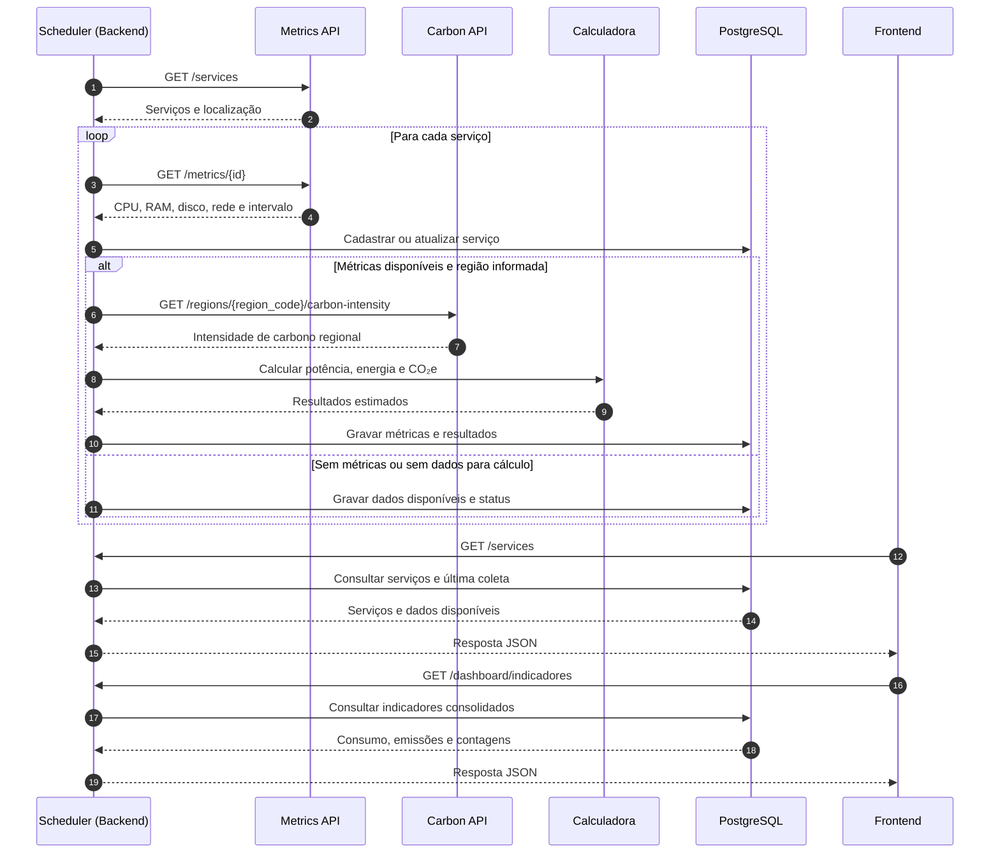
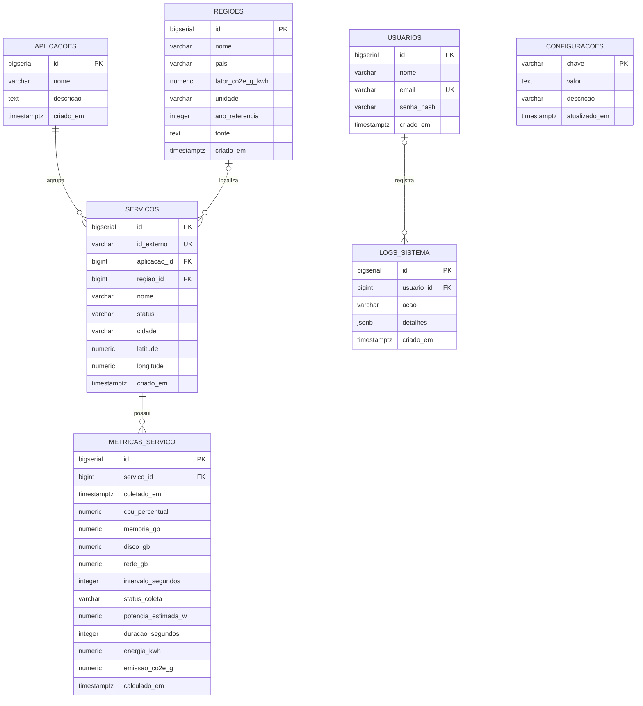

# 🏗️ Arquitetura e Modelo de Dados do GreenER

← [Voltar à documentação](README.md)

## 1. Visão geral

O **GreenER** é uma aplicação web de monitoramento ambiental de serviços computacionais. A plataforma recebe métricas de infraestrutura, como utilização de CPU, memória, disco e rede, e utiliza essas informações para estimar potência, consumo energético e emissões de dióxido de carbono equivalente (CO₂e).

O cálculo de emissões considera também a intensidade de carbono associada à região do serviço. Portanto, o GreenER apresenta **estimativas baseadas nas métricas e nos fatores configurados**, não uma medição elétrica direta do servidor.

A solução está organizada em quatro partes:

- **Frontend:** interface web que apresenta o estado dos serviços e os indicadores disponíveis.
- **Backend:** servidor HTTP, regras de negócio, integrações externas, autenticação e coordenação das coletas.
- **Banco de dados:** PostgreSQL, responsável por armazenar serviços, regiões, aplicações, usuários, configurações e histórico de coletas.
- **APIs externas:** fontes de métricas de infraestrutura e de intensidade de carbono regional.

## 2. Diagrama da arquitetura

O diagrama abaixo representa o fluxo implementado entre os componentes do GreenER.

```mermaid
flowchart TD
    U[Usuário] --> F[Frontend<br/>React + TypeScript]
    F -->|HTTP /api| N[Nginx]
    N -->|Proxy para backend:3000| B[Backend<br/>Node.js + TypeScript]

    B -->|Consulta e gravação SQL| DB[(PostgreSQL)]

    B -->|GET /services<br/>GET /metrics/{id}| M[Greener Metrics Aggregator API]
    M -->|Serviços, localização e métricas| B

    B -->|GET /regions/{code}/carbon-intensity| C[Greener Carbon Intensity API]
    C -->|Intensidade regional de carbono| B

    B -->|Indicadores, serviços e status| F
```

### 2.1 Responsabilidade de cada componente

| Componente | Responsabilidade |
|---|---|
| Frontend | Apresentar os dados recebidos, estados de carregamento e falha, serviços e indicadores. |
| Nginx | Servir os arquivos do frontend e encaminhar as chamadas iniciadas em `/api/` ao backend. |
| Backend | Receber requisições HTTP, executar regras de negócio, controlar coletas e acessar as integrações e o banco. |
| PostgreSQL | Persistir os cadastros e o histórico das coletas. |
| Metrics Aggregator API | Fornecer a lista de serviços, localização e métricas de infraestrutura. |
| Carbon Intensity API | Fornecer o fator regional de intensidade de carbono utilizado no cálculo de CO₂e. |

## 3. Frontend

O frontend foi desenvolvido com **React 19, TypeScript e Vite**. Sua responsabilidade é oferecer a interface de consulta do GreenER e consumir os dados disponibilizados pelo backend.

A aplicação organiza os arquivos em `frontend/src/`:

| Diretório ou arquivo | Responsabilidade |
|---|---|
| `App.tsx` | Composição principal da aplicação e configuração dos provedores. |
| `rotas.tsx` | Definição das rotas e associação com as páginas. |
| `caminhos.ts` | Centralização dos caminhos utilizados na navegação. |
| `pages/` | Páginas da aplicação, como início, login, dashboard e área administrativa. |
| `components/` | Componentes reutilizáveis da interface. |
| `services/` | Comunicação HTTP com o backend e normalização dos dados recebidos. |
| `hooks/` | Lógica reutilizável de estado e consulta de dados. |
| `contexts/` | Contextos compartilhados entre componentes. |
| `providers/` | Provedores de contexto utilizados pela aplicação. |
| `assets/` | Imagens e recursos visuais. |
| `utils/` | Funções auxiliares reutilizáveis. |

### 3.1 Comunicação com o backend

As chamadas HTTP do frontend utilizam o cliente centralizado em `frontend/src/services/api.ts`. A URL-base utilizada pela aplicação é `/api`.

No ambiente com Docker, o Nginx recebe as chamadas em `/api/` e as encaminha ao serviço `backend`, na porta `3000`. Em desenvolvimento, o frontend utiliza a configuração de proxy do Vite.

O cliente HTTP disponibiliza operações GET, POST e PUT. Quando existe um JWT armazenado, o token é enviado no cabeçalho `Authorization: Bearer <token>`.

### 3.2 Consultas realizadas pela interface

Entre as consultas utilizadas pela aplicação estão:

| Recurso | Endpoint | Finalidade |
|---|---|---|
| Prontidão do ambiente | `GET /health/ready` | Verificar a disponibilidade do backend e do PostgreSQL na tela de início. |
| Serviços | `GET /services` | Obter os serviços cadastrados e os dados da última coleta disponíveis na resposta. |
| Indicadores | `GET /dashboard/indicadores` | Consultar consumo, emissão e contagens de serviços. |
| Diagnóstico da coleta | `GET /collections/rotina/status` | Consultar o estado da rotina e as falhas ativas. |

O hook `useMonitoramentoColeta` consulta o diagnóstico da rotina a cada cinco segundos. A consulta da lista de serviços é realizada pelo hook `useServicos` na carga da tela e pode ser repetida pela ação de atualização.

## 4. Backend

O backend utiliza **Node.js e TypeScript**. Ele concentra as regras de negócio e intermedeia a comunicação entre o frontend, o PostgreSQL e as APIs externas.

O servidor HTTP é iniciado por `backend/src/server.ts`, enquanto `backend/src/app.ts` reúne as rotas e direciona cada requisição ao respectivo handler.

### 4.1 Organização em camadas

Os módulos do backend seguem, de forma geral, a separação:

**routes → controller → service → repository**

| Camada | Responsabilidade |
|---|---|
| Routes | Associa método HTTP e caminho à função que tratará a requisição. |
| Controller | Interpreta os dados da requisição, chama os serviços e monta a resposta HTTP. |
| Service | Coordena as regras de negócio e o fluxo de execução. |
| Repository | Executa as operações de leitura e gravação no PostgreSQL. |

### 4.2 Módulos implementados

Os principais módulos encontram-se em `backend/src/modules/`:

| Módulo | Responsabilidade |
|---|---|
| `auth/` | Autenticação de usuários, emissão e validação de JWT e limitação de tentativas de login. |
| `collections/` | Execução manual e periódica das coletas, consulta do histórico e diagnóstico da rotina. |
| `configuracoes/` | Consulta de configuração utilizada como intervalo alternativo da coleta. |
| `dashboard-indicators/` | Consolidação dos indicadores apresentados pelo dashboard. |
| `monitoring-settings/` | Consulta das configurações de monitoramento protegida por autenticação. |
| `resultados/` | Acesso aos resultados calculados persistidos. |
| `services/` | Consulta e persistência dos serviços monitorados. |

Outros diretórios relevantes:

| Diretório | Responsabilidade |
|---|---|
| `src/db/` | Criação do pool de conexões, execução de consultas e verificação de disponibilidade do PostgreSQL. |
| `src/integrations/` | Clientes e validações das respostas das APIs externas. |
| `src/calculos/` | Cálculos de potência, energia e emissões de CO₂e. |
| `src/mocks/` | Dados e servidor de apoio a cenários simulados e testes. |
| `src/shared/` | Funções HTTP compartilhadas entre os módulos. |

### 4.3 Inicialização da coleta periódica

Quando o servidor HTTP inicia, a coleta periódica é iniciada automaticamente por padrão. Esse comportamento pode ser controlado pela variável `COLLECTIONS_AUTO_START`.

A rotina realiza uma descoberta dos serviços e agenda coletas individuais. Cada serviço utiliza o intervalo informado pela API de métricas, quando válido. O intervalo alternativo configurado é utilizado como fallback.

A rotina também permite execução manual e consulta de status. Uma coleta de um mesmo serviço não é executada em paralelo com outra coleta pendente daquele serviço.

## 5. Integrações externas

O backend utiliza duas integrações externas, implementadas em `backend/src/integrations/`.

### 5.1 Greener Metrics Aggregator API

- Documentação: [https://metrics.unilaunch.org/docs](https://metrics.unilaunch.org/docs)
- URL base padrão: `https://metrics.unilaunch.org`
- Variável de configuração: `METRICS_API_URL`

A integração disponibiliza:

| Método | Endpoint externo | Finalidade |
|---|---|---|
| GET | `/services` | Listar os serviços monitorados e suas informações de localização. |
| GET | `/services/{id}` | Consultar um serviço pelo identificador externo. |
| GET | `/metrics/{id}` | Consultar métricas e intervalo de coleta de um serviço. |

As métricas utilizadas pelo GreenER incluem:

- `cpu_percent`: utilização de CPU em percentual;
- `memory_gb`: memória em GB;
- `disk_gb`: disco em GB;
- `network_gb`: rede em GB;
- `collection_interval_seconds`: intervalo de coleta em segundos.

### 5.2 Greener Carbon Intensity API

- Documentação: [https://carbon.unilaunch.org/docs](https://carbon.unilaunch.org/docs)
- URL base padrão: `https://carbon.unilaunch.org`
- Variável de configuração: `CARBON_API_URL`

A integração disponibiliza:

| Método | Endpoint externo | Finalidade |
|---|---|---|
| GET | `/regions` | Listar regiões disponíveis e seus fatores. |
| GET | `/regions/{codigo}` | Consultar uma região pelo código. |
| GET | `/regions/{codigo}/carbon-intensity` | Consultar a intensidade de carbono da região. |

O backend utiliza `location.region_code`, recebido da API de métricas, para consultar a intensidade de carbono correspondente ao serviço.

### 5.3 Tratamento das respostas externas

As duas integrações utilizam o cliente compartilhado `api-client.ts`, que:

- envia requisições GET com `Accept: application/json`;
- aplica o timeout configurado;
- valida se a resposta possui JSON válido;
- valida os campos esperados pelas integrações;
- classifica falhas como HTTP, timeout, rede ou resposta inválida.

Uma resposta inválida ou uma falha externa não deve ser convertida em métricas iguais a zero. Quando não há dados suficientes para concluir o cálculo, a aplicação preserva a informação disponível e representa os campos de cálculo ausentes como nulos.

## 6. Fluxo de dados da coleta ao dashboard

O fluxo a seguir representa a rotina de coleta e a disponibilização dos resultados.



### 6.1 Etapas do fluxo

1. **Descoberta:** o backend consulta a lista atual de serviços na Metrics Aggregator API.
2. **Identificação:** cada serviço é cadastrado ou atualizado no PostgreSQL pelo identificador externo.
3. **Coleta:** o backend consulta as métricas individuais do serviço.
4. **Consulta regional:** quando existe código de região, o backend consulta a intensidade de carbono correspondente.
5. **Cálculo:** a calculadora estima potência, energia e emissões de CO₂e.
6. **Persistência:** os dados brutos, o estado da coleta e os resultados disponíveis são gravados no histórico.
7. **Consulta:** o frontend solicita os serviços e os indicadores ao backend.
8. **Apresentação:** a interface exibe as informações recebidas, distinguindo valores disponíveis, estados sem métricas e falhas.

## 7. Cálculo de energia e emissões

O módulo `backend/src/calculos/calculo-energia.ts` reúne as funções responsáveis por calcular potência, energia e emissões.

Os fatores utilizados na estimativa de potência são:

| Recurso | Fator utilizado |
|---|---:|
| CPU a 100% de utilização | 100 W |
| RAM | 0,375 W por GB |
| Disco | 0,01 W por GB |
| Rede | 0,02 W por GB |

A potência estimada é calculada por:

\[
P(W) =
\left(\frac{CPU(\%)}{100} \times 100\right)
+ (RAM(GB) \times 0{,}375)
+ (Disco(GB) \times 0{,}01)
+ (Rede(GB) \times 0{,}02)
\]

A energia estimada é:

\[
E(kWh) = \frac{P(W) \times duração(segundos)}{3.600 \times 1.000}
\]

A emissão estimada é:

\[
CO_2e(g) = E(kWh) \times intensidade(gCO_2e/kWh)
\]

Os resultados são arredondados para oito casas decimais antes de serem persistidos. As fórmulas, unidades e premissas também estão descritas em [`calculos.md`](./calculos.md).

## 8. Modelo de dados

O banco de dados do GreenER utiliza **PostgreSQL**. A definição das tabelas está em `database/schema.sql`, os dados iniciais em `database/seed.sql` e as alterações para bancos já existentes em `database/migrations/`.

O modelo atual possui sete tabelas.

### 8.1 Diagrama entidade-relacionamento

O diagrama abaixo representa as relações definidas no `schema.sql`.



### 8.2 Descrição das tabelas

#### `configuracoes`

Armazena configurações gerais no formato chave/valor.

| Campo | Tipo | Descrição |
|---|---|---|
| `chave` | `VARCHAR(100)` | Chave primária da configuração. |
| `valor` | `TEXT` | Valor armazenado. |
| `descricao` | `VARCHAR(255)` | Descrição opcional da configuração. |
| `atualizado_em` | `TIMESTAMPTZ` | Data e hora da atualização. |

O seed inclui a configuração `intervalo_coleta_segundos`, com valor inicial de `60`.

#### `regioes`

Armazena as regiões e os fatores de intensidade de carbono utilizados nas estimativas.

| Campo | Tipo | Descrição |
|---|---|---|
| `id` | `BIGSERIAL` | Chave primária. |
| `nome` | `VARCHAR(100)` | Nome da região. |
| `pais` | `VARCHAR(100)` | País da região. |
| `fator_co2e_g_kwh` | `NUMERIC(10,4)` | Fator de emissão em gCO₂e/kWh. |
| `unidade` | `VARCHAR(20)` | Unidade do fator; padrão `gCO2e/kWh`. |
| `ano_referencia` | `INTEGER` | Ano de referência do fator. |
| `fonte` | `TEXT` | Fonte do fator. |
| `criado_em` | `TIMESTAMPTZ` | Data e hora de criação. |

A combinação de `nome` e `pais` é única.

#### `aplicacoes`

Agrupa os serviços monitorados.

| Campo | Tipo | Descrição |
|---|---|---|
| `id` | `BIGSERIAL` | Chave primária. |
| `nome` | `VARCHAR(120)` | Nome único da aplicação. |
| `descricao` | `TEXT` | Descrição opcional. |
| `criado_em` | `TIMESTAMPTZ` | Data e hora de criação. |

#### `usuarios`

Armazena os usuários que podem realizar login no sistema.

| Campo | Tipo | Descrição |
|---|---|---|
| `id` | `BIGSERIAL` | Chave primária. |
| `nome` | `VARCHAR(100)` | Nome do usuário. |
| `email` | `VARCHAR(150)` | E-mail único utilizado no login. |
| `senha_hash` | `VARCHAR(255)` | Hash da senha, não a senha em texto puro. |
| `criado_em` | `TIMESTAMPTZ` | Data e hora de criação. |

O schema atual não possui colunas de perfil ou status do usuário.

#### `logs_sistema`

Estrutura para registrar ações do sistema.

| Campo | Tipo | Descrição |
|---|---|---|
| `id` | `BIGSERIAL` | Chave primária. |
| `usuario_id` | `BIGINT` | Referência opcional a `usuarios`. |
| `acao` | `VARCHAR(100)` | Identificação da ação. |
| `detalhes` | `JSONB` | Detalhes adicionais em formato JSON. |
| `criado_em` | `TIMESTAMPTZ` | Data e hora do registro. |

O campo `usuario_id` aceita nulo, permitindo registros sem usuário associado. A tabela está definida no schema; isso não significa que todos os eventos da aplicação já sejam gravados nela.

#### `servicos`

Armazena os serviços monitorados e suas informações de localização.

| Campo | Tipo | Descrição |
|---|---|---|
| `id` | `BIGSERIAL` | Chave primária interna. |
| `id_externo` | `VARCHAR(100)` | Identificador do serviço na API de métricas; possui índice único. |
| `aplicacao_id` | `BIGINT` | Referência obrigatória a `aplicacoes`. |
| `regiao_id` | `BIGINT` | Referência opcional a `regioes`. |
| `nome` | `VARCHAR(120)` | Nome do serviço. |
| `status` | `VARCHAR(20)` | Estado do serviço: `ativo`, `indisponivel` ou `removido`. |
| `cidade` | `VARCHAR(100)` | Cidade, quando informada. |
| `latitude` | `NUMERIC(10,8)` | Latitude, quando disponível. |
| `longitude` | `NUMERIC(11,8)` | Longitude, quando disponível. |
| `criado_em` | `TIMESTAMPTZ` | Data e hora de criação. |

O identificador externo permite atualizar um cadastro existente sem criar um serviço duplicado. A região e as coordenadas podem ser nulas quando a API não fornece localização.

#### `metricas_servico`

Armazena o histórico de coletas e os resultados calculados disponíveis.

| Campo | Tipo | Descrição |
|---|---|---|
| `id` | `BIGSERIAL` | Chave primária da coleta. |
| `servico_id` | `BIGINT` | Referência obrigatória a `servicos`. |
| `coletado_em` | `TIMESTAMPTZ` | Data e hora da coleta. |
| `cpu_percentual` | `NUMERIC(5,2)` | Utilização da CPU em percentual. |
| `memoria_gb` | `NUMERIC(14,6)` | Memória em GB. |
| `disco_gb` | `NUMERIC(14,6)` | Disco em GB. |
| `rede_gb` | `NUMERIC(14,6)` | Rede em GB. |
| `intervalo_segundos` | `INTEGER` | Intervalo associado à coleta, em segundos. |
| `status_coleta` | `VARCHAR(20)` | `sucesso`, `sem_metricas` ou `indisponivel`. |
| `potencia_estimada_w` | `NUMERIC(16,8)` | Potência estimada em Watts. |
| `duracao_segundos` | `INTEGER` | Duração utilizada no cálculo, em segundos. |
| `energia_kwh` | `NUMERIC(18,8)` | Energia estimada em kWh. |
| `emissao_co2e_g` | `NUMERIC(18,8)` | Emissão estimada em gramas de CO₂e. |
| `calculado_em` | `TIMESTAMPTZ` | Data e hora do cálculo, quando realizado. |

Os campos de métricas e cálculo aceitam nulo para representar informações que não estavam disponíveis. Cada coleta gera um novo registro, preservando o histórico do serviço.

### 8.3 Relacionamentos

| Origem | Destino | Cardinalidade | Descrição |
|---|---|---|---|
| `aplicacoes` | `servicos` | 1:N | Uma aplicação pode agrupar vários serviços; cada serviço pertence a uma aplicação. |
| `regioes` | `servicos` | 1:N opcional | Uma região pode estar associada a vários serviços; um serviço pode não possuir região informada. |
| `servicos` | `metricas_servico` | 1:N | Um serviço pode possuir várias coletas; cada coleta pertence a um serviço. |
| `usuarios` | `logs_sistema` | 1:N opcional | Um usuário pode estar associado a vários registros; um registro pode não possuir usuário associado. |

A tabela `configuracoes` não possui chave estrangeira no schema atual.

### 8.4 Integridade e restrições

O schema aplica restrições para preservar a integridade dos dados:

- e-mail de usuário, nome de aplicação e identificador externo do serviço possuem unicidade;
- região é identificada pela combinação de nome e país;
- latitude e longitude possuem limites geográficos;
- CPU aceita valores entre 0 e 100;
- memória, disco, rede, potência, duração, energia e emissão não aceitam valores negativos;
- status de serviço e de coleta são limitados aos valores definidos no schema;
- os relacionamentos utilizam chaves estrangeiras para associar serviços, aplicações, regiões, coletas, usuários e logs.

### 8.5 Migrações do banco

Além do `schema.sql`, o repositório contém migrações para atualizar bancos já existentes:

| Arquivo | Objetivo |
|---|---|
| `001_persistencia_coletas.sql` | Adiciona o identificador externo aos serviços, cria sua unicidade e permite intervalo de coleta igual a zero. |
| `002_servico_sem_localizacao.sql` | Permite que `servicos.regiao_id` seja nulo quando a localização não estiver disponível. |

As migrações são destinadas a bancos já criados. Em um banco novo, a estrutura é criada pelo `schema.sql` e os dados iniciais são inseridos pelo `seed.sql`.

## 9. Autenticação e configuração

O módulo `auth/` autentica usuários por e-mail e senha. A senha é verificada a partir do hash armazenado no banco, e o backend emite um JWT assinado com HS256.

Características da implementação atual:

- validade do token: uma hora;
- variável de ambiente: `JWT_SECRET`;
- segredo deve conter pelo menos 32 bytes;
- o token identifica o usuário pelo campo `sub`;
- o middleware valida assinatura, algoritmo, emissor, audiência e expiração;
- `GET /monitoring-settings` exige o cabeçalho `Authorization: Bearer <token>`;
- `POST /auth/login` é uma rota pública.

O schema não possui, neste momento, colunas de perfil e status do usuário. A documentação não deve atribuir permissões por perfil que ainda não estejam implementadas.

## 10. Execução da aplicação

O repositório organiza a execução com Docker Compose, por meio do arquivo `compose.yaml`.

| Serviço | Função | Porta publicada padrão |
|---|---|---|
| `database` | Banco de dados PostgreSQL. | `5432` |
| `backend` | API HTTP, regras de negócio e coletas. | `3000` |
| `frontend` | Aplicação web servida pelo Nginx. | `8080` |

O volume `postgres_data` mantém os dados do PostgreSQL entre reinicializações dos containers. O backend aguarda a disponibilidade do banco antes de iniciar, e o frontend depende da condição de saúde do backend.

As variáveis de ambiente e os comandos de inicialização estão descritos no [README principal](../README.md) e no [README do backend](../backend/README.md).

## 11. Diagramas de referência da Sprint 1

A documentação reaproveita os diagramas criados na Sprint 1 como referência do desenho inicial do sistema:

- [Diagrama de casos de uso](./diagramas/diagrama-casos-de-uso.md)
- [Diagrama de classes](./diagramas/diagrama-classes.md)
- [Diagramas de sequência](./diagramas/diagrama-sequencia.md)

Os diagramas iniciais representam decisões e propostas feitas durante a primeira sprint. Para detalhes da implementação atual, devem prevalecer os caminhos, as rotas e as tabelas descritos neste documento e nos arquivos de código, especialmente `backend/src/app.ts`, `backend/src/modules/` e `database/schema.sql`.

## 12. Referências relacionadas

- [Documentação da API](./api.md)
- [Documentação dos cálculos](./calculos.md)
- [README do banco de dados](../database/README.md)
- [README do backend](../backend/README.md)
- [README do frontend](../frontend/README.md)
- [Schema do banco](../database/schema.sql)
- [Seed do banco](../database/seed.sql)

---

**Green Stack · FATEC Jacareí · Desenvolvimento de Software Multiplataforma · 2026**
