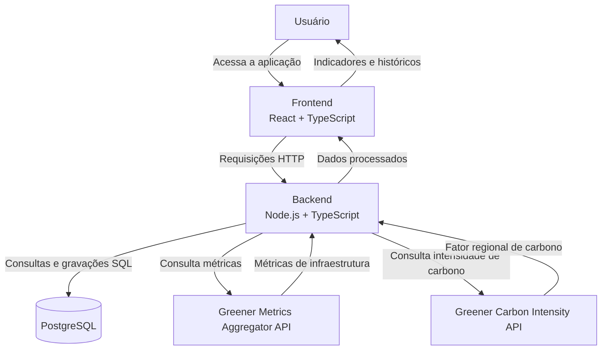

# 🏗️ Arquitetura do GreenER

 

## 1. Visão geral

O **GreenER** é uma aplicação web voltada ao monitoramento de serviços computacionais e à estimativa de seu impacto ambiental. A solução utiliza métricas de infraestrutura, como uso de CPU, memória RAM, disco e rede, combinadas com fatores regionais de intensidade de carbono para estimar o consumo energético e as emissões de dióxido de carbono equivalente (CO₂e).

A arquitetura está organizada em três partes principais:

- **Frontend:** interface utilizada para consultar e visualizar informações.
- **Backend:** camada responsável pelas regras de negócio, integração com serviços externos e coordenação das coletas.
- **Banco de dados:** camada de persistência das informações necessárias ao funcionamento da aplicação.

O projeto também prevê a comunicação com duas APIs auxiliares: uma para obtenção de métricas dos serviços monitorados e outra para consulta da intensidade de carbono regional.

 

## 2. Diagrama da arquitetura

O diagrama representa o fluxo lógico previsto. Os detalhes de comunicação, endpoints e disponibilidade de cada integração devem ser confirmados na implementação e na documentação específica das APIs.

 

## 3. Componentes da solução

### 3.1 Frontend

O frontend é a camada de apresentação do GreenER. Sua responsabilidade é oferecer uma interface para acompanhar os serviços monitorados e consultar os indicadores ambientais disponibilizados pelo backend.

Tecnologias previstas:

- React;
- TypeScript.

A estrutura planejada para o frontend organiza o código em diretórios com responsabilidades distintas:

| Diretório | Responsabilidade prevista |
|---|---|
| `components/` | Componentes de interface reutilizáveis. |
| `pages/` | Páginas e visões principais da aplicação. |
| `services/` | Comunicação com o backend. |
| `hooks/` | Hooks reutilizáveis para lógica de interface. |
| `contexts/` | Contextos compartilhados entre componentes. |
| `providers/` | Provedores de contexto e dependências da aplicação. |

O frontend não deve calcular indicadores a partir de premissas ocultas ou substituir as regras de negócio do backend. Ele apresenta os dados recebidos e, quando aplicável, permite que o usuário consulte filtros, históricos e comparações.

### 3.2 Backend

O backend concentra as regras de negócio e coordena a comunicação entre o frontend, o banco de dados e as APIs externas.

Tecnologias previstas:

- Node.js;
- TypeScript.

A estrutura planejada inclui:

| Arquivo ou diretório | Responsabilidade prevista |
|---|---|
| `src/app.ts` | Configuração da aplicação e dos componentes de servidor. |
| `src/server.ts` | Inicialização do servidor. |
| `src/db/connection.ts` | Configuração da conexão com o banco de dados. |
| `src/integrations/metrics-api.ts` | Integração com a API de métricas. |
| `src/integrations/carbon-api.ts` | Integração com a API de intensidade de carbono. |
| `src/modules/coletas/coletas.routes.ts` | Definição das rotas relacionadas às coletas. |
| `src/modules/coletas/coletas.controller.ts` | Recebimento das requisições e encaminhamento para a camada de serviço. |
| `src/modules/coletas/coletas.service.ts` | Coordenação das regras de negócio das coletas. |
| `src/modules/coletas/coletas.repository.ts` | Acesso e persistência dos dados relacionados às coletas. |

A separação entre rotas, controller, service e repository favorece a organização das responsabilidades: as rotas definem os caminhos disponíveis, o controller trata a entrada das requisições, o service coordena a lógica de negócio e o repository concentra o acesso aos dados.

### 3.3 Banco de dados

O projeto prevê o uso do **PostgreSQL** para persistir os dados necessários à aplicação. O esquema do banco deve ser mantido em arquivos SQL explícitos, conforme a organização prevista para a pasta `database/`.

| Arquivo | Responsabilidade prevista |
|---|---|
| `database/schema.sql` | Definição da estrutura do banco de dados. |
| `database/README.md` | Documentação relacionada à configuração e ao uso do banco. |

 

## 4. Integrações externas

O GreenER prevê duas integrações principais para obter informações necessárias às estimativas ambientais.

### 4.1 API de métricas

A integração identificada como `metrics-api.ts` se destina à comunicação com a **Greener Metrics Aggregator API**:

- Documentação: https://metrics.unilaunch.org/docs

Essa API é a fonte prevista para as métricas de infraestrutura dos serviços monitorados. A disponibilidade, o formato das respostas, os parâmetros e os intervalos de coleta devem seguir a documentação da API e o comportamento efetivamente implementado.

### 4.2 API de intensidade de carbono

A integração identificada como `carbon-api.ts` se destina à comunicação com a **Greener Carbon Intensity API**:

- Documentação: https://carbon.unilaunch.org/docs

Essa API fornece os fatores regionais de intensidade de carbono usados para relacionar o consumo energético estimado às emissões de CO₂e. A região consultada e a unidade do fator devem ser registradas e interpretadas conforme a documentação da fonte.

 

## 5. Fluxo de dados previsto

O fluxo lógico da aplicação pode ser resumido nas etapas a seguir:

1. **Consulta da interface:** o usuário acessa o frontend e solicita a visualização de informações de um serviço.
2. **Requisição ao backend:** o frontend envia uma requisição HTTP ao backend.
3. **Obtenção das métricas:** o backend consulta a integração de métricas para obter os dados disponíveis do serviço.
4. **Obtenção do fator regional:** o backend consulta a intensidade de carbono correspondente à região relevante, quando necessária ao cálculo.
5. **Validação e processamento:** o backend valida os dados recebidos e aplica as regras de cálculo documentadas em [`calculos.md`](./calculos.md).
6. **Persistência:** os dados que precisem ser mantidos são registrados no PostgreSQL, conforme o modelo de dados implementado.
7. **Apresentação:** o backend devolve os dados processados ao frontend, que os apresenta ao usuário.

 

## 6. Estimativa de energia e emissões

O GreenER não deve ser descrito como um medidor direto do consumo elétrico físico do servidor. A proposta é **estimar** o consumo energético a partir das métricas disponíveis e aplicar um fator de intensidade de carbono regional para estimar as emissões.

De forma conceitual, a relação é:

- **Consumo energético estimado:** calculado a partir das métricas e do método documentado no projeto.
- **Emissões estimadas de CO₂e:** consumo energético estimado multiplicado pelo fator de intensidade de carbono compatível em unidade e período.

As fórmulas completas, as unidades, as premissas, as fontes e as limitações devem estar documentadas em [`calculos.md`](./calculos.md). Não se deve comparar resultados sem verificar se os períodos, as unidades e os fatores utilizados são compatíveis.

 

## 7. Tratamento de dados ausentes ou indisponibilidade

As APIs externas e os serviços monitorados podem apresentar falhas, atrasos ou ausência de métricas. A implementação deve tratar essas situações de maneira explícita, sem apresentar dados ausentes como se fossem medições válidas.

O comportamento esperado deve ser definido e verificado para situações como:

- serviço sem métricas disponíveis;
- falha ou timeout em uma API externa;
- resposta incompleta ou inválida;
- fator regional de intensidade de carbono indisponível;
- falha de persistência no banco de dados.

Quando não houver dados suficientes para produzir uma estimativa confiável, a aplicação deve indicar a indisponibilidade ou a limitação do resultado, em vez de inventar valores. A política exata de tentativas, registros de erro e apresentação ao usuário deve acompanhar a implementação.

 

## 8. Segurança e configuração

As configurações necessárias para executar a aplicação devem ser mantidas fora do código-fonte sempre que contiverem credenciais ou dados específicos de ambiente. O arquivo `.env.example` pode documentar os nomes das variáveis necessárias sem incluir segredos reais.

A estrutura do projeto prevê autenticação JWT para funcionalidades de configuração protegidas no backend. As rotas que exigem autenticação, as permissões e a forma de validação devem ser confirmadas no código e descritas também em [`api.md`](./api.md).

Boas práticas importantes:

- não versionar senhas, tokens ou chaves reais;
- validar entradas recebidas pelas rotas;
- tratar erros das integrações externas sem expor informações sensíveis;
- restringir operações de configuração a usuários autorizados;
- evitar registrar tokens ou credenciais nos logs.

 

## 9. Execução e organização dos componentes

O repositório prevê arquivos Docker para os componentes e um arquivo `compose.yaml` na raiz para organizar a execução em contêineres. A configuração efetiva de serviços, portas, variáveis de ambiente e dependências deve ser verificada nesses arquivos antes de seguir instruções de execução.

A arquitetura do código e a configuração de infraestrutura são aspectos relacionados, mas diferentes: a primeira descreve responsabilidades e comunicação entre componentes; a segunda define como esses componentes são configurados e executados em um ambiente.

 

## 10. Considerações finais

A separação entre frontend, backend, banco de dados e integrações externas torna as responsabilidades mais claras e facilitam a manutenção e a evolução do GreenER. A documentação da arquitetura também ajuda a compreender o caminho percorrido pelos dados, identificar dependências externas e relacionar as decisões técnicas às regras de cálculo.  
 Para mais detalhes sobre a <b>Documentação Geral</b> clique <a href="https://github.com/greenstackfatec-tech/greener/blob/develop/docs/README.md">aqui</a>.

---

**FATEC Jacareí · Desenvolvimento de Software Multiplataforma · 2026**