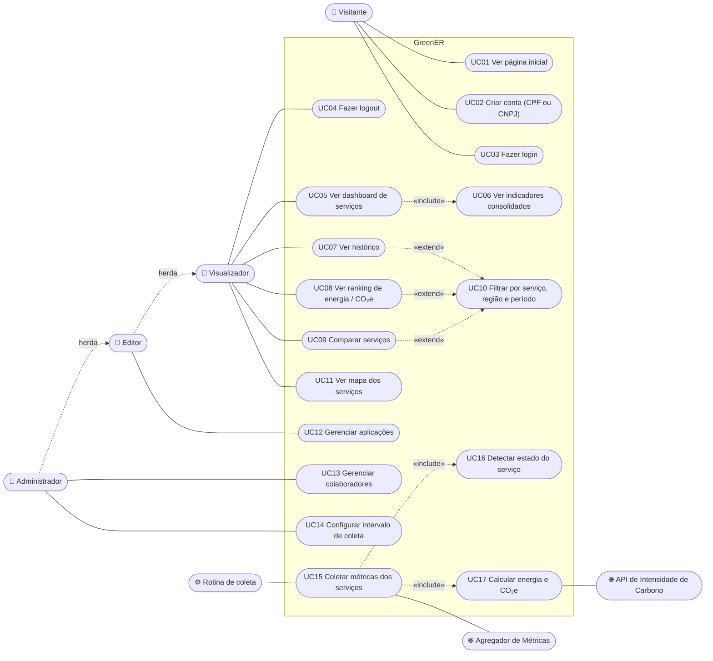

# Diagrama de Casos de Uso

← [Voltar aos diagramas](README.md)

> Tarefa: **ES-001** · Sprint 1
> Mostra quem usa o GreenER e o que cada um consegue fazer no sistema.

---

## Atores

| Ator | Tipo | Descrição |
| --- | --- | --- |
| **Visitante** | Principal | Pessoa sem login. Vê a página inicial, cria conta e entra no sistema. |
| **Visualizador** | Principal | Usuário logado. Consulta o dashboard, o histórico, o ranking e a comparação. |
| **Editor** | Principal | Tudo do Visualizador e ainda organiza as aplicações monitoradas. |
| **Administrador** | Principal | Tudo do Editor e ainda gerencia colaboradores e a configuração da coleta. |
| **Rotina de coleta** | Secundário (sistema) | Processo do backend que roda sozinho no intervalo configurado. |
| **Agregador de Métricas** | Secundário (API externa) | Informa os serviços e as métricas de CPU, memória, disco e rede. |
| **API de Intensidade de Carbono** | Secundário (API externa) | Informa o fator de emissão (gCO₂e/kWh) de cada região. |

Os perfis seguem a herança **Visualizador → Editor → Administrador**: cada perfil faz tudo o que o anterior faz.

---

## Diagrama

> Leitura das setas: **«include»** é um passo que sempre acontece junto; **«extend»** é opcional (o filtro só aparece se o usuário quiser usar).

---

## Descrição dos casos de uso

| ID | Caso de uso | Ator | Requisitos | Sprint |
| --- | --- | --- | --- | --- |
| UC01 | Ver página inicial | Visitante | RP05 | 1 |
| UC02 | Criar conta (CPF ou CNPJ) | Visitante | RP06 | 3 |
| UC03 | Fazer login | Visitante | RP06 | 3 |
| UC04 | Fazer logout | Visualizador | RP06 | 3 |
| UC05 | Ver dashboard com estado, localização, CPU, RAM, disco, rede, energia e CO₂e de cada serviço | Visualizador | RF01, RF09, RF11, RF12 | 2 |
| UC06 | Ver consumo total, emissão total, serviços ativos e indisponíveis | Visualizador | RF08 | 2 |
| UC07 | Ver histórico com gráficos | Visualizador | RF10 | 3 |
| UC08 | Ver ranking por energia ou CO₂e no período | Visualizador | RF14 | 3 |
| UC09 | Comparar dois ou mais serviços no mesmo período | Visualizador | RF15 | 3 |
| UC10 | Filtrar por serviço, região e período | Visualizador | RF10, RF14, RF15 | 3 |
| UC11 | Ver mapa dos serviços com latitude e longitude | Visualizador | RF13 (opcional) | 3 |
| UC12 | Cadastrar, editar e remover aplicações | Editor | RF01 | 3 |
| UC13 | Adicionar, editar e remover colaboradores; definir perfil e status | Administrador | RP06 | 3 |
| UC14 | Alterar o intervalo de coleta | Administrador | RF11 | 3 |
| UC15 | Consultar `/services` e `/metrics/{id}` e gravar cada coleta como novo estado | Rotina de coleta | RF01, RF03, RF04 | 1 |
| UC16 | Marcar o serviço como ativo, ativo sem métricas, indisponível, incluído, removido ou que retornou | Rotina de coleta | RF02, RF05, RF06 | 2 |
| UC17 | Calcular potência, energia e emissão de CO₂e de cada coleta | Rotina de coleta | RF07 | 2 |

## Histórico de alterações

| Data | Alteração | Responsável |
| --- | --- | --- |
| 19/10/2026 | Criação do diagrama de casos de uso | Renan |
