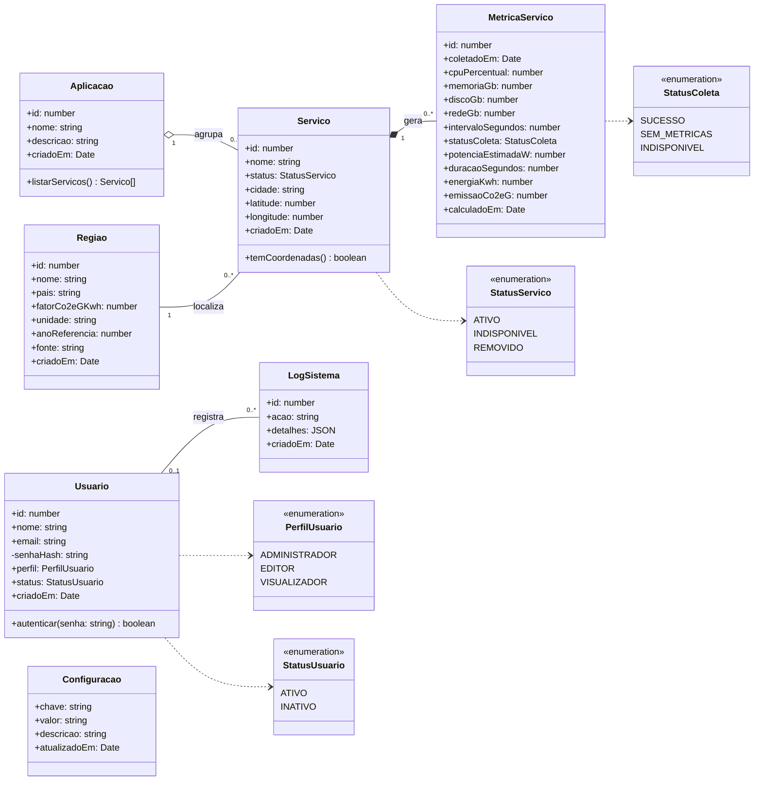
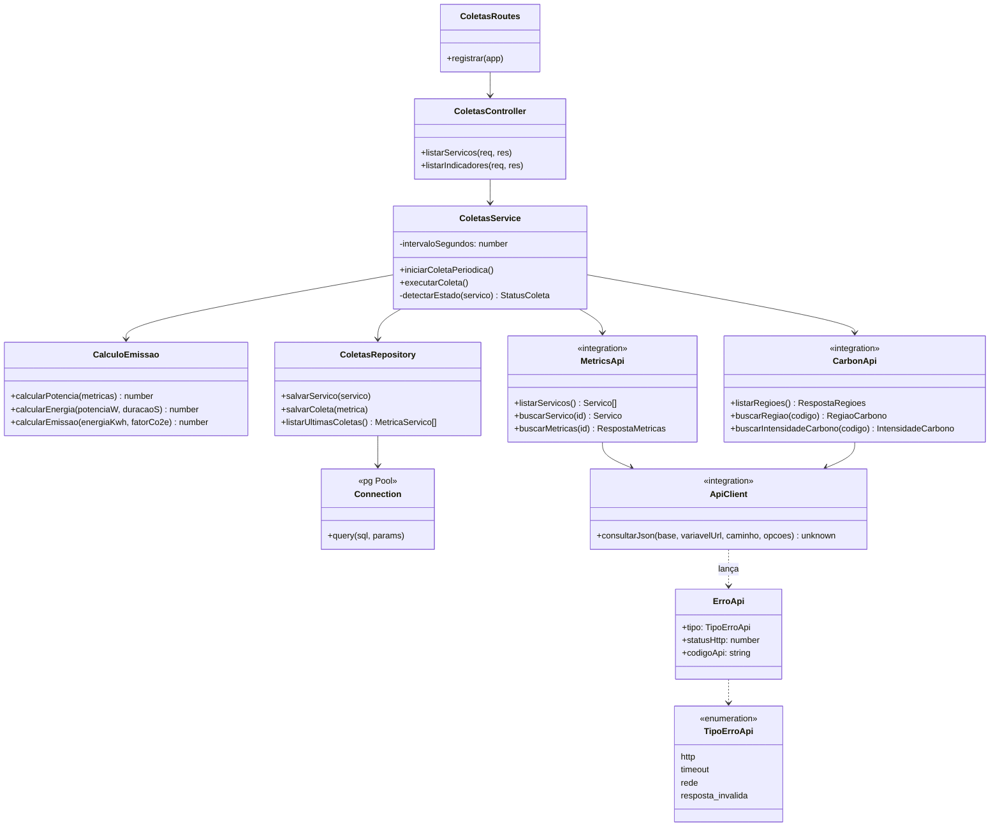

# Diagrama de Classes

← [Voltar aos diagramas](README.md)

> Tarefa: **DW-003** · Sprint 1
> Mostra as classes do domínio do GreenER, seus atributos e como se relacionam. Serve de base para a modelagem do banco ([`database/schema.sql`](../../database/schema.sql)).

---

## 1. Classes de domínio

Cada classe vira uma tabela no PostgreSQL. Os nomes dos atributos são os mesmos das colunas.

### Relacionamentos

| Relação | Multiplicidade | Significado |
| --- | --- | --- |
| Aplicação → Serviço | 1 para 0..* (agregação) | Uma aplicação agrupa vários serviços. |
| Região → Serviço | 1 para 0..* | Cada serviço fica em uma região, que tem o fator de emissão usado no cálculo. |
| Serviço → MetricaServico | 1 para 0..* (composição) | Cada coleta gera uma nova linha; ela não existe sem o serviço. |
| Usuário → LogSistema | 0..1 para 0..* | Uma ação pode ter usuário ou ser da rotina de coleta (sem usuário). |

> **Pendente no banco:** `perfil` e `status` do usuário aparecem nas telas de colaboradores ([design](../design/tela-colaboradores-opcoes-de-perfil.png)), mas ainda não existem como colunas em `usuarios` no `schema.sql`. Precisam ser adicionados quando o login (TP18) e a gestão de colaboradores forem implementados.

---

## 2. Classes do backend

Organização em camadas definida no backlog (TP02): **routes → controller → service → repository**, com as integrações externas separadas em `integrations/`.

| Classe | Arquivo | Situação |
| --- | --- | --- |
| `ApiClient`, `ErroApi` | `backend/src/integrations/api-client.ts` | Implementado |
| `MetricsApi` | `backend/src/integrations/metrics-api.ts` | Implementado |
| `CarbonApi` | `backend/src/integrations/carbon-api.ts` | Implementado |
| `Connection` | `backend/src/db/connection.ts` | Planejado (BD03) |
| `ColetasRoutes`, `ColetasController`, `ColetasService`, `ColetasRepository` | `backend/src/modules/coletas/` | Planejado (TP02, TP06, TP07, BD04) |
| `CalculoEmissao` | a definir | Planejado (TP09, Sprint 2) |

## Histórico de alterações

| Data | Alteração | Responsável |
| --- | --- | --- |
| 19/10/2026 | Criação do diagrama de classes | Renan |
