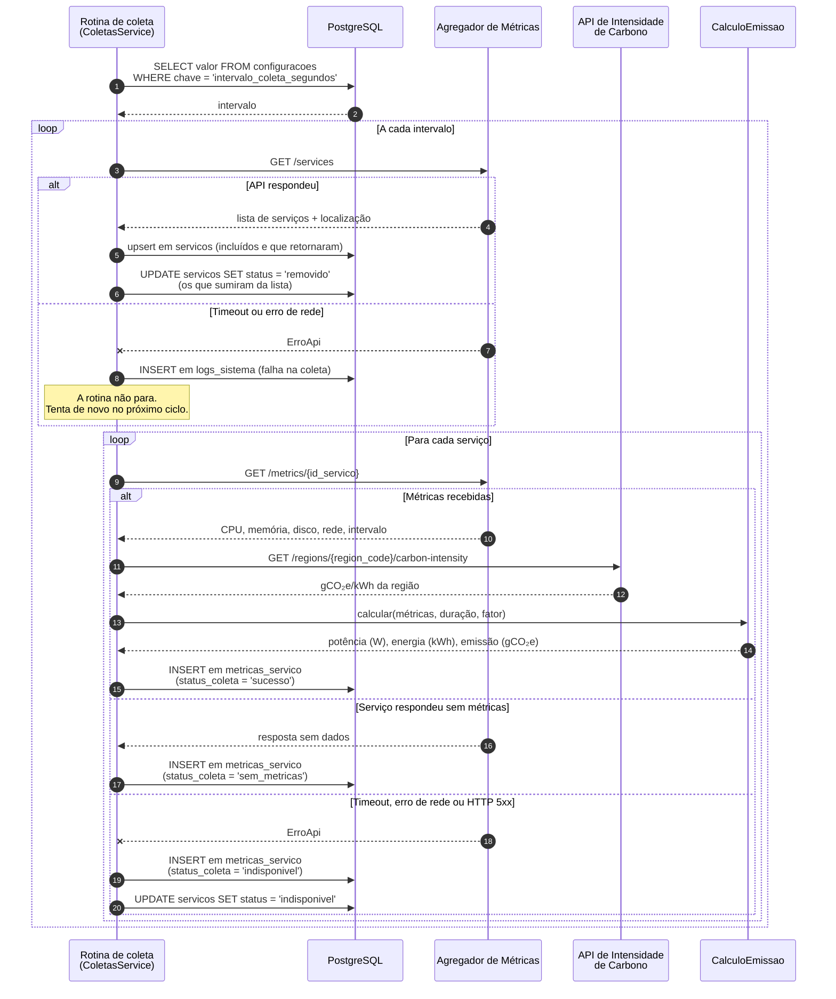
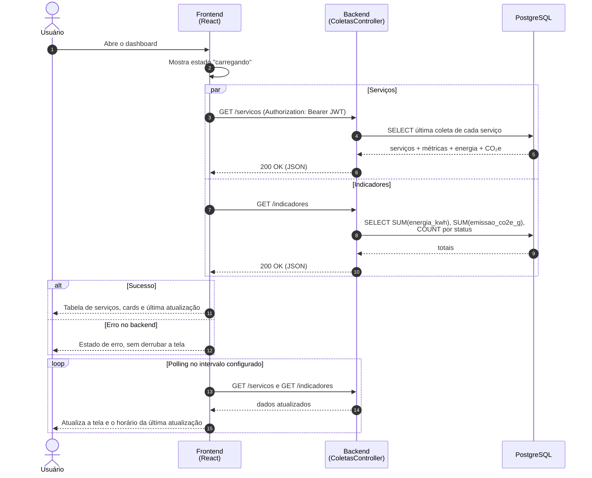
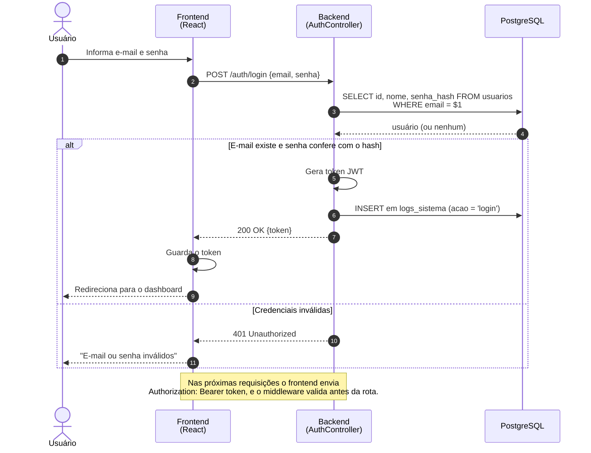

# Diagramas de Sequência

← [Voltar aos diagramas](README.md)

> Tarefa: **DW-003.1** · Sprint 1
> Mostram a ordem das mensagens entre as partes do sistema nos três fluxos principais do GreenER.

---

## 1. Coleta periódica de métricas

Fluxo principal do sistema (RF01, RF03, RF04, RF05, RF06, RF07, RNF04). Roda sozinho no intervalo configurado, sem ação do usuário.

---

## 2. Consulta do dashboard

O usuário abre o dashboard e a tela se atualiza sozinha (RF08, RF09, RF11, RNF02).

---

## 3. Login

Autenticação com JWT para acessar as rotas protegidas (RP06).

> Os endpoints `/servicos`, `/indicadores` e `/auth/login` são a proposta para as Sprints 2 e 3 (TP16, TP18). Se o nome mudar na implementação, atualize este diagrama e o [`docs/api.md`](../api.md).

## Histórico de alterações

| Data | Alteração | Responsável |
| --- | --- | --- |
| 19/10/2026 | Criação dos diagramas de sequência | Renan |
