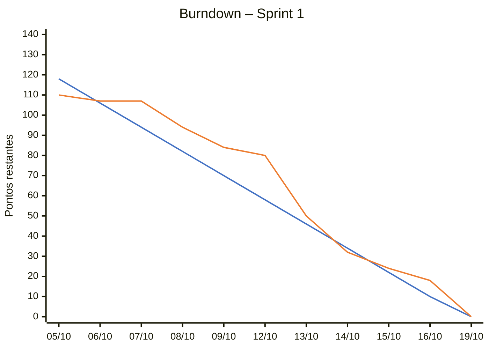

# Sprint 1

←  [Voltar ao README](../../README.md)

## 📝 Relatório da Sprint

Nesta sprint, a equipe focou na base do projeto. Foram definidas a identidade visual e prototipadas as telas essenciais do produto (início, login, cadastro CPF e CNPJ, colaboradores, administração e not found), em versões desktop e mobile. Em paralelo, o banco de dados foi modelado e implementado em PostgreSQL com Docker, as integrações com as APIs do cliente (Agregador de Métricas e Intensidade de Carbono) foram iniciadas no back-end e a documentação do projeto foi estruturada, incluindo os diagramas de casos de uso, classes e sequência.

 

## 💻 Demonstração do Produto
> Clique na imagem abaixo para assistir ao vídeo referente à primeira sprint.

[Sprint 1 - GreenER](https://youtu.be/gBj58b91ARw)

 

## 📢 Retrospectiva

#### 1. O que funcionou bem
- Entrega do escopo: todas as tarefas do Sprint Backlog foram concluídas, e o burndown fechou a sprint zerado. As demais tarefas previstas para a Sprint 1 no Product Backlog (backend, frontend, Docker e coleta) foram replanejadas para a Sprint 2.

- Colaboração: os integrantes se ajudaram nas tarefas e revisões, mesmo com ausências pontuais ao longo da sprint.

#### 2. O que não funcionou bem
- Atraso no início: entre 07/10 e 12/10 o realizado ficou acima da linha ideal, porque parte das tarefas dependia de outras entregas para começar.

- Assimetria de commits: a quantidade de commits ficou desigual entre os integrantes, pois algumas funções geram menos histórico no repositório.

- Entregas finais em cima da hora: o vídeo da review e os últimos ajustes de documentação foram concluídos perto do prazo.

#### 3. Plano de Ação para a Próxima Sprint
- Rotação de tarefas: alternar os tipos de atividade entre os integrantes para equilibrar o conhecimento e os commits.

- Dependências no Planning: mapear quais tarefas dependem de outras para que ninguém fique parado esperando uma entrega.

- Antecipar a review: definir roteiro, gravações e responsável pelo vídeo no início da última semana da sprint.

 

## 📉 Burndown

 

**Legenda:** 

🟦 Base Line (ritmo ideal)  
🟧 Realizado

 

## 🗃️ Documentos

### 📋 Sprint Backlog

 

| ID | Atividade | Prioridade | Pontuação | Disciplina | Andamento | Autor |
|---|---|---:|---:|---|---|---|
| BD-001 | Modelagem do banco de dados lógico | 7 | 8 | BD | ✅ Concluído | Thiago |
| DD-001 | Criar o design da tela de cadastro CNPJ | 9 | 3 | DD | ✅ Concluído | Guilherme |
| DD-001.1 | Criar o design da tela de cadastro CNPJ mobile | 9 | 3 | DD | ✅ Concluído | Guilherme |
| DD-001 | Criar o design da tela de cadastro CPF | 9 | 1 | DD | ✅ Concluído | Guilherme |
| DD-001.1 | Criar o design da tela de cadastro CPF mobile | 9 | 1 | DD | ✅ Concluído | Thiago |
| DD-002 | Criar o design da tela de login | 9 | 3 | DD | ✅ Concluído | Renan |
| DD-002.1 | Criar o design da tela de login mobile | 9 | 3 | DD | ✅ Concluído | Renan |
| DD-003 | Criar o design da homepage | 9 | 5 | DD | ✅ Concluído | Thiago |
| DD-003.1 | Criar o design da homepage mobile | 9 | 5 | DD | ✅ Concluído | Thiago |
| DD-004 | Criar o design da tela de início | 9 | 5 | DD | ✅ Concluído | Igor |
| DD-004 | Criar o design da tela de início mobile | 9 | 5 | DD | ✅ Concluído | Igor |
| DD-004.1 | Tela colaboradores | 8 | 3 | DD | ✅ Concluído | Julia |
| DD-004.1 | Tela colaboradores mobile | 8 | 3 | DD | ✅ Concluído | Julia |
| DD-005 | Definir paleta de cores | 10 | 1 | DD | ✅ Concluído | Todos |
| DD-004 | Criar o design da tela not found | 7 | 3 | DD | ✅ Concluído | Guilherme |
| DD-004 | Criar o design da tela not found mobile | 7 | 3 | DD | ✅ Concluído | Renan |
| DD-006 | Criar logo para o projeto | 9 | 1 | DD | ✅ Concluído | Guilherme |
| DD-007 | Criar logo para a equipe | 9 | 1 | DD | ✅ Concluído | Renan |
| DW-002 | Conectar Greener Metrics Aggregator API | 8 | 8 | DW | ✅ Concluído | Julia |
| DW-002.1 | Conectar Greener Carbon Intensity API | 8 | 5 | DW | ✅ Concluído | Julia |
| DW-003 | Desenvolver diagrama de classes | 8 | 8 | DW | ✅ Concluído | Fernanda |
| DW-003.1 | Desenvolver diagrama de sequência | 8 | 8 | DW | ✅ Concluído | Guilherme |
| DW-004 | Criar README.md principal | 10 | 3 | DW | ✅ Concluído | Fernanda |
| ES-001 | Desenvolver diagrama de caso de uso | 8 | 8 | EWS | ✅ Concluído | Fernanda |
| ES-002 | Documentar requisitos e backlog | 10 | 8 | EWS | ✅ Concluído | Igor |
| LP-001 | Carregar dados no SGBD | 7 | 3 | LPA | ✅ Concluído | Renan |

### 📊 Pontos por dia

 

| Dia | Base Line | Realizado |
|---|---:|---:|
| 05/10 | 118 | 110 |
| 06/10 | 106 | 107 |
| 07/10 | 94 | 107 |
| 08/10 | 82 | 94 |
| 09/10 | 70 | 84 |
| 12/10 | 58 | 80 |
| 13/10 | 46 | 50 |
| 14/10 | 34 | 32 |
| 15/10 | 22 | 24 |
| 16/10 | 10 | 18 |
| 19/10 | 0 | 0 |

### 🗒️ Atas das Daily Meetings

 

Registro das daily meetings da Sprint 1 (05/10/2026 a 16/10/2026), com participantes, andamento de cada integrante, impedimentos e avisos.

📄 [Ver atas da Sprint 1 (PDF)](./atas-sprint-1.pdf)

