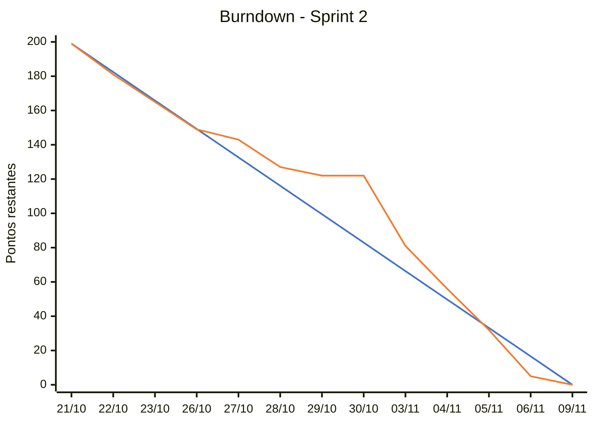

# Sprint 2

←  [Voltar ao README](../../README.md)

## 📝 Relatório da Sprint

Nessa sprint, a equipe entrega uma versão funcional do sistema: coleta dados dos serviços do cliente, calcula potência, energia e emissão de CO₂e, e mostra tudo em um dashboard com autenticação em JWT.
 
   

  ### 🎯 O que a sprint entrega 
 
#### Backend e coleta de dados

Backend organizado em módulos (routes, controllers, services, repositories).
Rotina de coleta periódica das APIs do cliente, com mocks locais e tratamento de erros e timeouts.
Gravação de serviços e coletas no banco.
Detecção de serviços incluídos, removidos, que retornaram, indisponíveis ou ativos sem métricas.
Tratamento de localização e coordenadas ausentes.
Autenticação JWT e proteção das rotas de configuração.

#### Cálculos e indicadores

Classe de cálculo de potência, energia e CO₂e, com gravação do resultado.
Indicadores consolidados: consumo, emissão, serviços ativos e indisponíveis.
Endpoints de serviços e indicadores.

#### Banco de dados

Repositories com SQL parametrizado para serviços, coletas e resultados calculados.
Consultas de histórico, indicadores, ranking e comparação.
README do banco com a ordem e os comandos dos scripts.

#### Frontend

Projeto React + TypeScript com rotas e cliente HTTP configurados.
Telas de login, cadastro, início e administrativa.
Dashboard com tabela de serviços (estado, localização, métricas, energia e CO₂e) e cards de indicadores.
Atualização automática com horário da última atualização.
Estados visuais de carregando, erro, indisponível e sem métricas.
Dados mockados removidos e todas as telas responsivas para mobile.

#### Design

Protótipos das telas de ranking, comparação, histórico, login e área de configuração.
Definição dos estados visuais do sistema.

#### Documentação e processo

Convenção de Git, plano de entregas com DoD completo e Sprint Backlog da Sprint 2.
READMEs (principal, backend e frontend), documentação da arquitetura, do modelo de dados, dos cálculos (docs/calculos.md) e dos endpoints (docs/api.md).
Atas das Dailies e vídeo da Sprint Review (roteiro, gravação, edição e publicação).

 

## 💻 Demonstração do Produto

> Clique na imagem abaixo para assistir ao vídeo referente à segunda sprint.

[Sprint 2 - GreenER](#)

 
## 📢 Retrospectiva

#### 1. O que funcionou bem

Durante a Sprint 2, a equipe conseguiu avançar na estruturação e integração dos principais componentes do GreenER, evoluindo tanto no frontend quanto no backend. A divisão das atividades por responsáveis e áreas de conhecimento contribuiu para organizar o desenvolvimento e permitir que diferentes partes do sistema fossem trabalhadas em paralelo.

A utilização do GitHub para gerenciamento das tarefas, acompanhamento das entregas e revisão de Pull Requests ajudou a manter o histórico das alterações e facilitou a colaboração entre os integrantes.

Também houve evolução na comunicação da equipe por meio das Dailies, que permitiram compartilhar o andamento das atividades, identificar dificuldades e alinhar prioridades. A documentação técnica foi ampliada, contribuindo para deixar o projeto mais organizado e facilitar sua continuidade.

#### 2. O que não funcionou bem

Um dos principais desafios da Sprint foi a disponibilidade de tempo dos integrantes. Durante o período, ocorreram atividades acadêmicas e institucionais, como o Halloween da FATEC e palestras, que reduziram o tempo disponível para o desenvolvimento em determinados dias.

Além disso, os feriados e dias sem atividades acadêmicas regulares impactaram a quantidade de dias úteis disponíveis para execução das tarefas. Isso exigiu adaptações no planejamento e concentrou parte das entregas nos últimos dias da Sprint.

Outro ponto de dificuldade foi a integração entre frontend, backend e banco de dados. Algumas atividades dependiam da conclusão de outras, gerando atrasos e dificultando o avanço independente de determinadas tarefas.

Também foi necessário dedicar tempo à resolução de problemas técnicos, ajustes de implementação e validação das funcionalidades, atividades que nem sempre foram previstas com precisão na estimativa inicial.

#### 3. Plano de Ação para a Próxima Sprint

Para a próxima Sprint, a equipe pretende melhorar o planejamento considerando o calendário acadêmico, incluindo previamente feriados, palestras, eventos institucionais e outras atividades que possam reduzir a disponibilidade dos integrantes.

As principais ações serão:

- **Planejamento mais realista:** considerar apenas os dias efetivamente disponíveis para desenvolvimento ao definir a capacidade da Sprint.
- **Melhor distribuição das tarefas:** equilibrar a quantidade de atividades entre os integrantes, considerando a complexidade e a dependência entre elas.
- **Antecipação das integrações:** realizar integrações entre frontend, backend e banco de dados ao longo da Sprint, evitando concentrar essa etapa no final.
- **Acompanhamento contínuo:** manter as Dailies atualizadas e registrar impedimentos assim que forem identificados.
- **Revisão frequente do Backlog:** acompanhar o andamento das tarefas e reorganizar prioridades quando necessário.
- **Validação antecipada:** testar as funcionalidades durante o desenvolvimento, reduzindo o acúmulo de correções próximo à entrega.
- **Melhoria nas estimativas:** utilizar a experiência da Sprint 2 para estimar melhor o esforço necessário para cada atividade.

O objetivo é tornar o desenvolvimento mais previsível, reduzir atrasos causados por dependências e imprevistos e garantir uma distribuição mais equilibrada do trabalho durante toda a próxima Sprint.

 

## 📉 Burndown

 

**Legenda:**  

🟦 Base Line (ritmo ideal)  
🟧 Realizado

 

## 🗃️ Documentos

### 📋 Sprint Backlog

 

| ID | Atividade | Prioridade | Pontuação | Disciplina | Andamento | Autor |
|---|---|---:|---:|---|---|---|
| DW-01 | Criar o projeto frontend com React + TypeScript e organizar as pastas | 10 | 8 | DW | ✅ Concluída | Renan |
| DW-02 | Configurar as rotas entre as telas e o cliente HTTP | 9 | 5 | DW | ✅ Concluída | Renan |
| BD-04 | Repositories com SQL parametrizado para serviços e coletas | 9 | 8 | BD | ✅ Concluída | Renan |
| BD-05 | Repository dos resultados calculados (potência, energia e CO₂e) | 8 | 5 | BD | ✅ Concluída | Renan |
| TP-16 | Endpoints de serviços e indicadores | 8 | 5 | TP | ✅ Concluída | Renan |
| TP-15 | Tratar localização e coordenadas ausentes | 7 | 2 | TP | ✅ Concluída | Renan |
| S2 | Editar e publicar o vídeo da Sprint Review | 6 | 4 | S2 | ✅ Concluída | Renan |
| TP-09 | Classe de cálculo (potência, energia e CO₂e) e gravar o resultado | 9 | 8 | TP | ✅ Concluída | Igor |
| TP-10 | Indicadores consolidados: consumo, emissão, ativos e indisponíveis | 8 | 3 | TP | ✅ Concluída | Igor |
| DD-04 | Protótipo da tela de ranking | 8 | 4 | DD | ✅ Concluída | Igor |
| DD-05 | Protótipo da tela de comparação | 8 | 4 | DD | ✅ Concluída | Igor |
| BD-06 | Consultas SQL de histórico, indicadores, ranking e comparação | 7 | 5 | BD | ✅ Concluída | Igor |
| S2 | Roteiro e gravação do vídeo da Sprint Review | 7 | 4 | S2 | ✅ Concluída | Igor |
| ES-11 | Documentar os cálculos (docs/calculos.md) | 6 | 2 | EWS | ✅ Concluída | Igor |
| TP-03 | Investigar as APIs do cliente e criar mocks locais | 10 | 3 | TP | ✅ Concluída | Julia |
| TP-07 | Gravar serviços e coletas no banco | 9 | 5 | TP | ✅ Concluída | Julia |
| TP-06 | Rotina de coleta periódica | 8 | 5 | TP | ✅ Concluída | Julia |
| TP-14 | Tratar erros e timeouts das chamadas externas | 8 | 3 | TP | ✅ Concluída | Julia |
| TP-18 | Autenticação JWT no backend e proteção das rotas de configuração | 8 | 8 | TP | ✅ Concluída | Julia |
| TP-11 | Detectar serviços incluídos, removidos e que retornaram | 7 | 8 | TP | ✅ Concluída | Julia |
| TP-12 | Detectar serviço indisponível | 7 | 2 | TP | ✅ Concluída | Julia |
| TP-13 | Detectar serviço ativo sem métricas | 7 | 2 | TP | ✅ Concluída | Julia |
| TP-02 | Organizar o backend em módulos (routes, controllers, services, repositories) | 10 | 8 | TP | ✅ Concluída | Guilherme |
| DW-19 | Tela de login | 8 | 5 | DW | ✅ Concluída | Guilherme |
| DW-20 | Tela de cadastro | 8 | 5 | DW | ✅ Concluída | Guilherme |
| DW-21 | Tela administrativa | 7 | 5 | DW | ✅ Concluída | Guilherme |
| DW-06 | Cards de indicadores consolidados | 7 | 3 | DW | ✅ Concluída | Guilherme |
| DW-22 | Retirar os dados mockados das telas | 6 | 3 | DW | ✅ Concluída | Guilherme |
| DW-10 | Responsividade de todas as telas para mobile | 6 | 5 | DW | ✅ Concluída | Guilherme |
| BD-07 | README do banco com a ordem e os comandos dos scripts | 10 | 2 | BD | ✅ Concluída | Thiago |
| DD-07 | Estados visuais: carregando, erro, indisponível e sem métricas | 10 | 5 | DD | ✅ Concluída | Thiago |
| DD-08 | Protótipo da tela de histórico | 8 | 5 | DD | ✅ Concluída | Thiago |
| DD-06 | Protótipo do login e da área de configuração | 8 | 3 | DD | ✅ Concluída | Thiago |
| DW-05 | Dashboard: tabela de serviços com estado, localização, métricas, energia e CO₂e | 7 | 8 | DW | ✅ Concluída | Thiago |
| DW-07 | Estados visuais na tela, carregando e erro | 7 | 5 | DW | ✅ Concluída | Thiago |
| DW-08 | Atualização automática e horário da última atualização | 6 | 3 | DW | ✅ Concluída | Thiago |
| DW-09 | Exibir país, região e cidade de cada serviço | 6 | 3 | DW | ✅ Concluída | Thiago |
| ES-05 | Convenção de Git (branch, commit e PR com o ID da tarefa) | 10 | 2 | EWS | ✅ Concluída | Fernanda |
| ES-02 | Plano de entregas no modelo da rubrica + DoD completa | 9 | 5 | EWS | ✅ Concluída | Fernanda |
| DW-18 | Tela de início responsiva | 9 | 5 | DW | ✅ Concluída | Fernanda |
| ES-09 | README principal com as tecnologias atualizadas | 6 | 1 | EWS | ✅ Concluída | Fernanda |
| ES-17 | READMEs do backend e do frontend | 6 | 3 | EWS | ✅ Concluída | Fernanda |
| ES-10 | Documentar a arquitetura e o modelo de dados | 6 | 2 | EWS | ✅ Concluída | Fernanda |
| ES-12 | Documentar os endpoints da API (docs/api.md) | 6 | 3 | EWS | ✅ Concluída | Fernanda |
| S2 | Registrar as atas das Dailies | 6 | 2 | S2 | ✅ Concluída | Fernanda |
| ES-07 | Sprint Backlog da Sprint 2 e registro da Sprint Review | 6 | 5 | EWS | ✅ Concluída | Fernanda |

  
### 📊 Pontos por dia

 

| Dia | Base Line | Realizado |
|---|---:|---:|
| 21/10 | 199 | 199 |
| 22/10 | 182.42 | 181 |
| 23/10 | 165.83 | 165 |
| 26/10 | 149.25 | 149 |
| 27/10 | 132.67 | 143 |
| 28/10 | 116.08 | 127 |
| 29/10 | 99.50 | 122 |
| 30/10 | 82.92 | 122 |
| 03/11 | 66.33 | 81 |
| 04/11 | 49.75 | 56 |
| 05/11 | 33.17 | 32 |
| 06/11 | 16.58 | 5 |
| 09/11 | 0 | 0 |

### 🗒️ Atas das Daily Meetings

 

| Dia | Data | Renan | Igor | Júlia | Guilherme | Thiago | Fernanda | Obs. |
|---:|---|---|---|---|---|---|---|---|
| 1 | 21/10 (qua) | Sprint Planning | Sprint Planning | Sprint Planning | Sprint Planning | Sprint Planning | Sprint Planning | Todos participaram do planejamento da Sprint, alinhando tarefas, prazos, estimativas e prioridades. |
| 2 | 22/10 (qui) | Início da estruturação do frontend com React e TypeScript | Atualização do Product Backlog e revisão das regras de cálculo | Investigação das APIs do cliente e criação de mocks locais | Estruturação inicial do backend em Node.js e TypeScript | Definição dos estados visuais da aplicação | Organização do Sprint Backlog, plano de entregas e atas das Dailys | Redução de 18 pontos. Início do desenvolvimento e distribuição das atividades. |
| 3 | 23/10 (sex) | Organização das pastas e componentes iniciais do frontend | Implementação da classe de cálculo de potência, energia e CO₂e | Análise das respostas das APIs e estruturação dos dados simulados | Organização dos módulos, rotas e serviços do backend | Prototipação da tela de histórico e versões mobile | Registro da Daily, revisão das documentações e acompanhamento dos PRs | Redução de 16 pontos. Avanço das estruturas iniciais do sistema. |
| 4 | 26/10 (seg) | Configuração das rotas e estruturação do cliente HTTP | Continuidade das classes de cálculo e indicadores consolidados | Implementação da rotina de coleta periódica e tratamento dos dados recebidos | Desenvolvimento das regras de negócio e integração inicial com o banco | Desenvolvimento dos protótipos de ranking e comparação | Atualização do plano de entregas, organização das atas e acompanhamento das tarefas | Redução de 16 pontos. Evolução das estruturas de frontend, backend e integração. |
| 5 | 27/10 (ter) | Desenvolvimento dos repositories e consultas parametrizadas | Revisão das classes de cálculo e consultas SQL | Continuidade da investigação das APIs e tratamento de erros | Continuidade da organização e implementação dos módulos do backend | Ajustes dos protótipos e revisão dos estados visuais | Documentação da convenção de Git e organização dos registros da Sprint | Redução de 6 pontos. Continuidade das implementações e documentação. |
| 6 | 28/10 (qua) | Desenvolvimento dos repositories de serviços e coletas | Implementação das consultas de histórico e indicadores | Integração dos dados coletados com o banco de dados | Implementação das funcionalidades de persistência e regras do backend | Revisão dos estados visuais e prototipação do histórico | Registro das Dailys, atualização do backlog e acompanhamento dos PRs | Redução de 16 pontos. Avanço das funcionalidades de persistência e cálculos. |
| 7 | 29/10 (qui) | Desenvolvimento dos endpoints de serviços e indicadores | Revisão das regras de cálculo e validação dos resultados | Tratamento de falhas nas chamadas externas e continuidade da integração | Implementação das funcionalidades de serviços e autenticação | Ajustes dos protótipos e revisão da interface | Atualização da documentação e acompanhamento das entregas | Redução de 5 pontos. Avanço pontual nas funcionalidades do sistema. |
| 8 | 30/10 (sex) | Revisão das funcionalidades de frontend e integração com o backend | Revisão das classes e cálculos implementados | Validação dos mocks e das integrações das APIs | Ajustes na estrutura do backend e integração com o banco | Revisão dos componentes visuais e protótipos | Registro da Daily, revisão de PRs e atualização documental | Sem redução de pontos no Burndown. Dia dedicado à continuidade, integração e revisão das atividades. |
| 9 | 03/11 (ter) | Tratamento de localização e coordenadas ausentes e ajustes dos endpoints | Implementação dos indicadores consolidados, consultas e documentação dos cálculos | Implementação da coleta de dados, autenticação e tratamento dos serviços | Implementação das funcionalidades de backend, persistência e integração | Desenvolvimento do dashboard, tabela de serviços e indicadores | Desenvolvimento da tela inicial responsiva e atualização dos registros das Dailys | Redução de 41 pontos. Concentração de entregas e conclusão de funcionalidades importantes da Sprint. |
| 10 | 04/11 (qua) | Ajustes dos endpoints e revisão da integração com o frontend | Revisão das implementações de cálculo, consultas e resultados | Validação da coleta periódica, autenticação e tratamento dos dados | Ajustes das funcionalidades de backend e integração com banco de dados | Desenvolvimento dos estados visuais e atualização automática do dashboard | Atualização da documentação de arquitetura, modelo de dados e plano de entregas | Redução de 25 pontos. Consolidação das funcionalidades e integração entre os módulos. |
| 11 | 05/11 (qui) | Correções e validação das funcionalidades de frontend e repositories | Revisão dos cálculos, indicadores e consultas de histórico | Testes das integrações e tratamento de erros das APIs | Correções das funcionalidades e validação da persistência de dados | Ajustes da interface, localização e componentes do dashboard | Organização das atas, documentação dos endpoints e READMEs | Redução de 24 pontos. Avanço na validação e correção das funcionalidades implementadas. |
| 12 | 06/11 (sex) | Revisão final dos endpoints e funcionalidades de frontend | Revisão final das classes, cálculos e indicadores | Validação das integrações, coleta e autenticação | Revisão final do backend, persistência e integração | Validação visual do dashboard, estados e atualização automática | Consolidação da documentação, revisão dos PRs e preparação dos registros da Sprint | Redução de 27 pontos. Fechamento interno do desenvolvimento, restando 5 pontos. |
| 13 | 09/11 (seg) | Apresentação e revisão das entregas de frontend | Apresentação e revisão das implementações de cálculo | Validação dos resultados da coleta e integrações | Apresentação e revisão das funcionalidades do backend | Revisão visual da aplicação e demonstração do dashboard | Consolidação dos registros, documentação e retrospectiva da Sprint | Redução final de 5 pontos. Sprint Review e encerramento do acompanhamento, com 0 pontos restantes no Burndown. |

