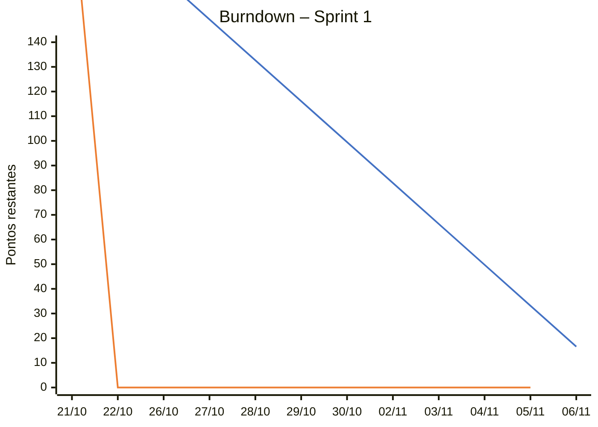

# Sprint 2

←  [Voltar ao README](../../README.md)

## 📝 Relatório da Sprint

Nessa sprint, a equipe entrega uma versão funcional do sistema: coleta dados dos serviços do cliente, calcula potência, energia e emissão de CO₂e, e mostra tudo em um dashboard com autenticação em JWT.
 
   

  ### 🎯 O que a sprint entrega 
 
#### Backend e coleta de dados

Backend organizado em módulos (routes, controllers, services, repositories).
Rotina de coleta periódica das APIs do cliente, com mocks locais e tratamento de erros e timeouts.
Gravação de serviços e coletas no banco.
Detecção de serviços incluídos, removidos, que retornaram, indisponíveis ou ativos sem métricas.
Tratamento de localização e coordenadas ausentes.
Autenticação JWT e proteção das rotas de configuração.

#### Cálculos e indicadores

Classe de cálculo de potência, energia e CO₂e, com gravação do resultado.
Indicadores consolidados: consumo, emissão, serviços ativos e indisponíveis.
Endpoints de serviços e indicadores.

#### Banco de dados

Repositories com SQL parametrizado para serviços, coletas e resultados calculados.
Consultas de histórico, indicadores, ranking e comparação.
README do banco com a ordem e os comandos dos scripts.

#### Frontend

Projeto React + TypeScript com rotas e cliente HTTP configurados.
Telas de login, cadastro, início e administrativa.
Dashboard com tabela de serviços (estado, localização, métricas, energia e CO₂e) e cards de indicadores.
Atualização automática com horário da última atualização.
Estados visuais de carregando, erro, indisponível e sem métricas.
Dados mockados removidos e todas as telas responsivas para mobile.

#### Design

Protótipos das telas de ranking, comparação, histórico, login e área de configuração.
Definição dos estados visuais do sistema.

#### Documentação e processo

Convenção de Git, plano de entregas com DoD completo e Sprint Backlog da Sprint 2.
READMEs (principal, backend e frontend), documentação da arquitetura, do modelo de dados, dos cálculos (docs/calculos.md) e dos endpoints (docs/api.md).
Atas das Dailies e vídeo da Sprint Review (roteiro, gravação, edição e publicação).

 

## 💻 Demonstração do Produto
> Clique na imagem abaixo para assistir ao vídeo referente à primeira sprint.

[Sprint 2 - GreenER](#)

 

## 📢 Retrospectiva

#### 1. O que funcionou bem

(Detelhamento) 

#### 2. O que não funcionou bem

(Detelhamento)

#### 3. Plano de Ação para a Próxima Sprint

(Detelhamento)

 

## 📉 Burndown

 

**Legenda:**  

🟦 Base Line (ritmo ideal)  
🟧 Realizado

 

## 🗃️ Documentos

### 📋 Sprint Backlog

 

| ID | Atividade | Prioridade | Pontuação | Disciplina | Andamento | Autor |
|---|---|---:|---:|---|---|---|
| DW-01 | Criar o projeto frontend com React + TypeScript e organizar as pastas | 10 | 8 | DW | ⏳ A fazer | Renan |
| DW-02 | Configurar as rotas entre as telas e o cliente HTTP | 9 | 5 | DW | ⏳ A fazer | Renan |
| BD-04 | Repositories com SQL parametrizado para serviços e coletas | 9 | 8 | BD | ⏳ A fazer | Renan |
| BD-05 | Repository dos resultados calculados (potência, energia e CO₂e) | 8 | 5 | BD | ⏳ A fazer | Renan |
| TP-16 | Endpoints de serviços e indicadores | 8 | 5 | TP | ⏳ A fazer | Renan |
| TP-15 | Tratar localização e coordenadas ausentes | 7 | 2 | TP | ⏳ A fazer | Renan |
| S2 | Editar e publicar o vídeo da Sprint Review | 6 | 4 | S2 | ⏳ A fazer | Renan |
| TP-09 | Classe de cálculo (potência, energia e CO₂e) e gravar o resultado | 9 | 8 | TP | ⏳ A fazer | Igor |
| TP-10 | Indicadores consolidados: consumo, emissão, ativos e indisponíveis | 8 | 3 | TP | ⏳ A fazer | Igor |
| DD-04 | Protótipo da tela de ranking | 8 | 4 | DD | ⏳ A fazer | Igor |
| DD-04 | Protótipo da tela de comparação | 8 | 4 | DD | ⏳ A fazer | Igor |
| BD-06 | Consultas SQL de histórico, indicadores, ranking e comparação | 7 | 5 | BD | ⏳ A fazer | Igor |
| S2 | Roteiro e gravação do vídeo da Sprint Review | 7 | 4 | S2 | ⏳ A fazer | Igor |
| ES-11 | Documentar os cálculos (docs/calculos.md) | 6 | 2 | EWS | ⏳ A fazer | Igor |
| TP-03 | Investigar as APIs do cliente e criar mocks locais | 10 | 3 | TP | ⏳ A fazer | Julia |
| TP-07 | Gravar serviços e coletas no banco | 9 | 5 | TP | ⏳ A fazer | Julia |
| TP-06 | Rotina de coleta periódica | 8 | 5 | TP | ⏳ A fazer | Julia |
| TP-14 | Tratar erros e timeouts das chamadas externas | 8 | 3 | TP | ⏳ A fazer | Julia |
| TP-18 | Autenticação JWT no backend e proteção das rotas de configuração | 8 | 8 | TP | ⏳ A fazer | Julia |
| TP-11 | Detectar serviços incluídos, removidos e que retornaram | 7 | 8 | TP | ⏳ A fazer | Julia |
| TP-12 | Detectar serviço indisponível | 7 | 2 | TP | ⏳ A fazer | Julia |
| TP-13 | Detectar serviço ativo sem métricas | 7 | 2 | TP | ⏳ A fazer | Julia |
| TP-02 | Organizar o backend em módulos (routes, controllers, services, repositories) | 10 | 8 | TP | ⏳ A fazer | Guilherme |
| DW-19 | Tela de login | 8 | 5 | DW | ⏳ A fazer | Guilherme |
| DW-20 | Tela de cadastro | 8 | 5 | DW | ⏳ A fazer | Guilherme |
| DW-21 | Tela administrativa | 7 | 5 | DW | ⏳ A fazer | Guilherme |
| DW-06 | Cards de indicadores consolidados | 7 | 3 | DW | ⏳ A fazer | Guilherme |
| DW-22 | Retirar os dados mockados das telas | 6 | 3 | DW | ⏳ A fazer | Guilherme |
| DW-10 | Responsividade de todas as telas para mobile | 6 | 5 | DW | ⏳ A fazer | Guilherme |
| BD-07 | README do banco com a ordem e os comandos dos scripts | 10 | 2 | BD | ⏳ A fazer | Thiago |
| DD-07 | Estados visuais: carregando, erro, indisponível e sem métricas | 10 | 5 | DD | ⏳ A fazer | Thiago |
| DD-04 | Protótipo da tela de histórico | 8 | 5 | DD | ⏳ A fazer | Thiago |
| DD-06 | Protótipo do login e da área de configuração | 8 | 3 | DD | ⏳ A fazer | Thiago |
| DW-05 | Dashboard: tabela de serviços com estado, localização, métricas, energia e CO₂e | 7 | 8 | DW | ⏳ A fazer | Thiago |
| DW-07 | Estados visuais na tela, carregando e erro | 7 | 5 | DW | ⏳ A fazer | Thiago |
| DW-08 | Atualização automática e horário da última atualização | 6 | 3 | DW | ⏳ A fazer | Thiago |
| DW-09 | Exibir país, região e cidade de cada serviço | 6 | 3 | DW | ⏳ A fazer | Thiago |
| ES-05 | Convenção de Git (branch, commit e PR com o ID da tarefa) | 10 | 2 | EWS | ⏳ A fazer | Fernanda |
| ES-02 | Plano de entregas no modelo da rubrica + DoD completa | 9 | 5 | EWS | ⏳ A fazer | Fernanda |
| DW-18 | Tela de início responsiva | 9 | 5 | DW | ⏳ A fazer | Fernanda |
| ES-09 | README principal com as tecnologias atualizadas | 6 | 1 | EWS | ⏳ A fazer | Fernanda |
| ES-17 | READMEs do backend e do frontend | 6 | 3 | EWS | ⏳ A fazer | Fernanda |
| ES-10 | Documentar a arquitetura e o modelo de dados | 6 | 2 | EWS | ⏳ A fazer | Fernanda |
| ES-12 | Documentar os endpoints da API (docs/api.md) | 6 | 3 | EWS | ⏳ A fazer | Fernanda |
| S2 | Registrar as atas das Dailies | 6 | 2 | S2 | ⏳ A fazer | Fernanda |
| ES-07 | Sprint Backlog da Sprint 2 e registro da Sprint Review | 6 | 5 | EWS | ⏳ A fazer | Fernanda |

  
### 📊 Pontos por dia

 

| Dia | Base Line | Realizado |
|---|---:|---:|
| 21/10 | 199 | 199 |
| 22/10 | 182.42 | - |
| 23/10 | 165.83 | - |
| 26/10 | 149.25 | - |
| 27/10 | 132.67 | - |
| 28/10 | 116.08 | - |
| 29/10 | 99.5 | - |
| 30/10 | 82.92 | - |
| 02/11 | 66.33 | - |
| 03/11 | 49.75 | - |
| 04/11 | 33.17 | - |
| 05/11 | 16.58 | - |
| 06/11 | 0 | - |

### 🗒️ Atas das Daily Meetings

 

Registro das daily meetings da Sprint 2 (21/10/2026 a 09/11/2026), com participantes, andamento de cada integrante, impedimentos e avisos.

📄 [Ver atas da Sprint 1 (PDF)](#)

