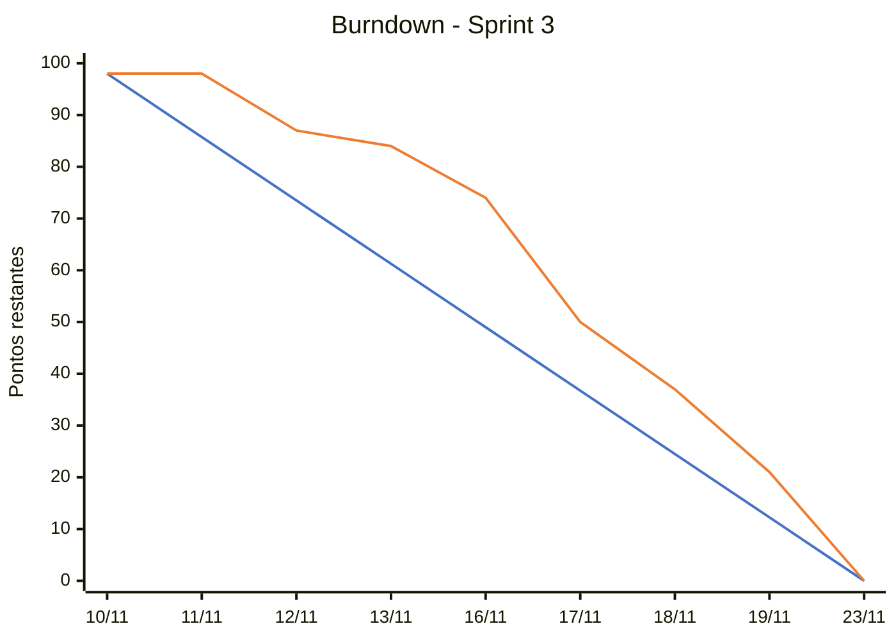

# Sprint 3

←  [Voltar ao README](../../README.md)

## 📝 Relatório da Sprint

Nessa sprint, a equipe avançou na evolução do GreenER com foco nas funcionalidades de análise, autenticação e visualização dos serviços. Foram implementados os endpoints de histórico, ranking e comparação, os filtros por serviço, região e período, além das telas correspondentes no frontend. Também houve melhorias na segurança das rotas, no acompanhamento das coletas, na responsividade e na organização técnica do projeto.

A sprint encerra o ciclo de desenvolvimento das principais funcionalidades, mas ainda mantém atividades de configuração, documentação final, validação em clone limpo e preparação da apresentação pendentes.

 

### 🎯 O que a sprint entrega

#### Backend e APIs de análise

Implementação dos endpoints de histórico, ranking e comparação, com filtros por período.
Proteção das rotas de leitura do dashboard e de controle da coleta com autenticação JWT.
Implementação do cadastro público de usuários.
Ajuste da rotina de coleta para utilizar o intervalo definido pela aplicação.
Complemento dos indicadores com a data e hora da última coleta e o intervalo configurado.
Testes de coletas consecutivas para comprovar a persistência de observações distintas.

#### Autenticação e segurança

Proteção das páginas internas, exigindo login para acessar o dashboard e as demais telas privadas.
Tratamento de respostas HTTP 401, com limpeza do token e redirecionamento para o login.
Implementação do fluxo de cadastro no backend, com validação dos dados e armazenamento seguro da senha.
Implementação do botão de logout nas telas privadas.

#### Frontend e análise de dados

Tela de histórico com gráfico de linha para acompanhar energia e CO₂e por serviço.
Tela de comparação de dois a cinco serviços no mesmo período.
Tela de ranking por energia ou CO₂e, com filtros, ordenação, resumo e tendência.
Filtros por serviço, região e período, preservados durante a atualização da tela.
Tela de mapa com globo 3D e localização dos serviços que possuem coordenadas.
Melhorias no dashboard, incluindo a exibição das métricas de recursos.
Separação visual entre consumo de energia (kWh) e emissão de CO₂e.
Padronização dos breakpoints para desktop e celular.
Remoção de componentes fictícios, cards sem dados e páginas sem rota.

#### Qualidade e infraestrutura

Correção da execução do projeto em clone limpo, incluindo ajustes de configuração do ambiente.
Configuração do ESLint no backend e inclusão da verificação de lint no CI.
Ampliação dos testes de integração e validação das funcionalidades.
Correção de problemas no carregamento das telas de login e cadastro.
Remoção de arquivos de teste e referências obsoletas do README.

#### Design

Aprimoramento do protótipo do mapa/globo, incluindo as versões desktop e mobile e o estado de serviço sem coordenadas.
Adequação visual das novas telas de histórico, ranking, comparação e mapa ao padrão de navegação do sistema.

#### Documentação e processo

Atualização do contrato das rotas de análise, configuração e cadastro em `docs/api.md`.
Atualizações pontuais nos READMEs relacionadas às funcionalidades implementadas.
Organização do Sprint Backlog, acompanhamento das tarefas, responsáveis e prazos.
Registro das Dailies e preparação do material da Sprint Review permanecem como atividades de fechamento.
A atualização geral da documentação para refletir a versão final ainda está pendente.

 

## 💻 Demonstração do Produto

> Clique no link abaixo para assistir ao vídeo referente à terceira sprint.

[Sprint 3 - GreenER](#)

 

## 📢 Retrospectiva

#### 1. O que funcionou bem

Durante a Sprint 3, a equipe conseguiu avançar nas funcionalidades de análise que ampliam o uso do GreenER para além do dashboard principal. A implementação dos endpoints e das telas de histórico, ranking e comparação permitiu apresentar informações por período e analisar diferentes serviços.

A integração entre frontend e backend evoluiu com o uso dos contratos de API, dos filtros compartilhados e da autenticação JWT. O trabalho também foi acompanhado por testes automatizados, revisões de Pull Requests e verificações de qualidade no CI.

A divisão das atividades por responsáveis permitiu que diferentes frentes fossem desenvolvidas em paralelo. As Dailies e o acompanhamento do backlog ajudaram a organizar as prioridades, acompanhar dependências e identificar o que precisava de atenção para o fechamento da sprint.

Também houve avanços importantes na experiência de uso, com a inclusão do mapa, a padronização da responsividade e a diferenciação entre consumo de energia e emissão de CO₂e.

#### 2. O que não funcionou bem

Algumas entregas foram concluídas próximas ao encerramento da sprint, concentrando integração, ajustes de interface e correções nos últimos dias. Isso exigiu revisões e compatibilizações entre as telas novas e a estrutura existente do frontend.

#### 3. Plano de Ação para a Entrega Final

Como esta é a última sprint, o foco passa a ser a conclusão das pendências e a preparação de uma entrega consistente e verificável.

As principais ações serão:

- **Concluir a configuração:** implementar e validar o endpoint de atualização do intervalo de coleta, finalizando a parte pendente da área administrativa.
- **Atualizar a documentação:** revisar o README principal, os READMEs do frontend, backend e banco de dados, os documentos de arquitetura, cálculos e API, além do plano de entregas.
- **Validar um clone limpo:** seguir as instruções documentadas em um ambiente novo, subir a aplicação, realizar login e conferir as telas.
- **Finalizar os registros:** completar as atas das Dailies, atualizar o Sprint Backlog e registrar as decisões e pendências da Review.
- **Preparar a apresentação:** concluir o roteiro, gravar a demonstração, editar e publicar o vídeo da Sprint Review.
- **Revisar a versão final:** executar testes, typecheck, lint, build e verificações de integração, além de conferir a responsividade das telas.

O objetivo é garantir que a versão entregue esteja funcional, documentada e reproduzível, sem depender de configurações ou instruções que não estejam registradas no repositório.

 

## 📉 Burndown

 

**Legenda:**  

🟦 Base Line (ritmo ideal)  
🟧 Realizado

 

## 🗃️ Documentos

### 📋 Sprint Backlog

 

| ID | Atividade | Prioridade | Pontuação | Disciplina | Andamento | Autor |
|---|---|---:|---:|---|---|---|
| [TP-17](https://github.com/greenstackfatec-tech/greener/issues/175) | Criar os endpoints de histórico, ranking e comparação com filtro de período | 10 | 5 | TP | ✅ Concluída | Igor |
| [DW-14](https://github.com/greenstackfatec-tech/greener/issues/188) | Implementar os filtros por serviço, região e período, preservados durante a atualização | 9 | 3 | DW | ✅ Concluída | Renan |
| [DD-05](https://github.com/greenstackfatec-tech/greener/issues/189) | Aprimorar o protótipo do mapa/globo, incluindo mobile e serviço sem coordenadas | 7 | 3 | DD | ✅ Concluída | Guilherme |
| [TP-19](https://github.com/greenstackfatec-tech/greener/issues/181) | Usar o intervalo de coleta fixo definido pela aplicação | 9 | 3 | TP | ✅ Concluída | Júlia |
| [TP-16](https://github.com/greenstackfatec-tech/greener/issues/182) | Exibir a hora da última coleta e os intervalos nos indicadores | 9 | 5 | TP | ✅ Concluída | Renan |
| [DW-16](https://github.com/greenstackfatec-tech/greener/issues/184) | Tratar o token vencido em todas as requisições protegidas | 10 | 5 | DW | ✅ Concluída | Thiago |
| [TP-18](https://github.com/greenstackfatec-tech/greener/issues/179) e [#180](https://github.com/greenstackfatec-tech/greener/issues/180) | Implementar cadastro de usuários, login JWT e proteção das rotas | 10 | 8 | TP | ✅ Concluída | Júlia |
| [TP-06](https://github.com/greenstackfatec-tech/greener/issues/194) | Validar coletas consecutivas com valores diferentes para o mesmo serviço | 8 | 5 | TP | ✅ Concluída | Júlia |
| [DW-05](https://github.com/greenstackfatec-tech/greener/issues/195) | Conferir o dashboard contra o RF09 e corrigir o que faltar | 8 | 8 | DW | ✅ Concluída | Thiago |
| [ES-12](https://github.com/greenstackfatec-tech/greener/issues/176) | Documentar o contrato das rotas novas em `docs/api.md` | 8 | 3 | ES | ✅ Concluída | Fernanda |
| [DW-11](https://github.com/greenstackfatec-tech/greener/issues/185) | Desenvolver a tela de histórico com gráfico de linha | 9 | 8 | DW | ✅ Concluída | Thiago |
| [DW-13](https://github.com/greenstackfatec-tech/greener/issues/187) | Desenvolver a tela de comparação de dois a cinco serviços | 9 | 5 | DW | ✅ Concluída | Renan |
| [DW-15](https://github.com/greenstackfatec-tech/greener/issues/190) | Desenvolver a tela do mapa/globo com as coordenadas dos serviços | 7 | 3 | DW | ✅ Concluída | Guilherme |
| [DW-12](https://github.com/greenstackfatec-tech/greener/issues/186) | Desenvolver a tela de ranking por energia ou CO₂e | 9 | 5 | DW | ✅ Concluída | Júlia |
| [DW-10](https://github.com/greenstackfatec-tech/greener/issues/191) | Padronizar a responsividade para desktop e celular | 8 | 5 | DW | ✅ Concluída | Thiago |
| [DW-22](https://github.com/greenstackfatec-tech/greener/issues/198) | Limpar o frontend, removendo componentes fictícios e páginas sem rota | 7 | 3 | DW | ✅ Concluída | Igor |
| [DW-17](https://github.com/greenstackfatec-tech/greener/issues/196) | Implementar a área de configuração do intervalo de coleta e o logout | 7 | 3 | DW | ⚠️ Parcial: logout concluído; configuração pendente | Guilherme |
| [ES-08](https://github.com/greenstackfatec-tech/greener/issues/178) | Criar o Sprint Backlog da Sprint 3, manter o burndown e registrar a Sprint Review | 10 | 5 | ES | ✅ Concluída | Fernanda |
| ES-14 | Preparar a apresentação final | 8 | 5 | ES | ✅ Concluída | Fernanda e equipe |
| [ES-15](https://github.com/greenstackfatec-tech/greener/issues/200) | Conferir comandos, links e instruções em um clone limpo | 9 | 3 | ES | ✅ Concluída | Fernanda e equipe |
| [ES-16](https://github.com/greenstackfatec-tech/greener/issues/199) | Registrar as atas das Daily Meetings da Sprint 3 | 8 | 2 | ES | ✅ Concluídae | Fernanda |
| TP-21 | Medir e ajustar o desempenho do dashboard e das consultas | 6 | 3 | TP | ✅ Concluída | Equipe |

#### Atividades adicionais e de fechamento

As issues abaixo também fizeram parte do trabalho realizado ou do fechamento da sprint. Elas não possuem pontuação própria na baseline de 98 pontos, por isso não alteram os valores do burndown.

| ID / Issue | Atividade | Andamento | Responsável |
|---|---|---|---|
| [S3-04 / #183](https://github.com/greenstackfatec-tech/greener/issues/183) | Exigir login para abrir o dashboard e as telas internas | ✅ Concluída | Thiago |
| [S3-05 / #192](https://github.com/greenstackfatec-tech/greener/issues/192) | Diferenciar o consumo de energia da pegada de carbono no aplicativo | ✅ Concluída | Igor |
| [DW-23 / #197](https://github.com/greenstackfatec-tech/greener/issues/197) | Configurar ESLint no backend e adicionar lint e typecheck ao CI | ✅ Concluída | Igor |
| [ES-09 / #201](https://github.com/greenstackfatec-tech/greener/issues/201) | Atualizar toda a documentação para a versão final | ✅ Concluída | Fernanda |
| [S3 / #202](https://github.com/greenstackfatec-tech/greener/issues/202) | Preparar o roteiro e gravar o vídeo da Sprint Review | ✅ Concluídae | Igor |
| [S3 / #203](https://github.com/greenstackfatec-tech/greener/issues/203) | Editar e publicar o vídeo da Sprint Review | ✅ Concluída | Renan |

### 📊 Pontos por dia

 

| Dia | Base Line | Realizado |
|---|---:|---:|
| 10/11 | 98 | 98 |
| 11/11 | 85,75 | 98 |
| 12/11 | 73,50 | 87 |
| 13/11 | 61,25 | 84 |
| 16/11 | 49 | 74 |
| 17/11 | 36,75 | 50 |
| 18/11 | 24,50 | 37 |
| 19/11 | 12,25 | 21 |
| 23/11 | 0 | 0 |

### 🗒️ Atas das Daily Meetings

 

| Dia | Data | Renan | Igor | Júlia | Guilherme | Thiago | Fernanda | Obs. |
|---:|---|---|---|---|---|---|---|---|
| 1 | 10/11 (ter) | Sprint Planning | Sprint Planning | Sprint Planning | Sprint Planning | Sprint Planning | Sprint Planning e organização do planejamento | A equipe definiu o objetivo da Sprint 3, distribuiu as atividades e alinhou prioridades. Fernanda, como Scrum Master, organizou as tarefas, os responsáveis e os prazos para acompanhamento. |
| 2 | 11/11 (qua) | Organização inicial dos filtros e das telas de análise | Preparação das consultas de histórico, ranking e comparação | Alinhamento das atividades de autenticação e intervalo de coleta | Continuidade do protótipo do mapa e dos estados de interface | Planejamento da proteção das telas internas e do tratamento de sessão | Organização do Sprint Backlog, distribuição das tarefas e acompanhamento dos prazos | Dia de alinhamento e início das frentes de trabalho. Sem redução de pontos registrada no burndown. |
| 3 | 12/11 (qui) | Implementação dos filtros por serviço, região e período | Implementação dos endpoints de histórico, ranking e comparação | Alinhamento dos ajustes do intervalo de coleta e autenticação | Aprimoramento e publicação do protótipo do mapa/globo | Implementação da exigência de login para as telas internas | Organização das prioridades, acompanhamento das entregas e das dependências | Redução de 11 pontos: entrega dos filtros, endpoints de análise e protótipo do mapa. |
| 4 | 13/11 (sex) | Continuidade da integração dos filtros e dos indicadores | Validação das consultas e dos contratos de análise | Implementação do intervalo de coleta definido pela aplicação | Revisão dos protótipos e dos estados previstos para o mapa | Continuidade do tratamento do token e das respostas de autenticação | Acompanhamento das tarefas, prazos e revisão do contrato da API | Redução de 3 pontos com a conclusão do ajuste do intervalo de coleta. |
| 5 | 16/11 (seg) | Implementação da data da última coleta e dos intervalos nos indicadores | Apoio na validação da integração entre análise, indicadores e cálculo | Continuidade do cadastro e da proteção JWT no backend | Acompanhamento dos ajustes de interface e integração | Tratamento de token vencido, limpeza da sessão e retorno ao login | Organização das atividades e acompanhamento das entregas de backend e frontend | Redução de 10 pontos: atualização dos indicadores e tratamento do token expirado. |
| 6 | 17/11 (ter) | Acompanhamento da integração dos indicadores com o dashboard | Diferenciação visual entre consumo de energia e emissão de CO₂e | Implementação do cadastro público e proteção das rotas com JWT | Apoio na validação visual e integração das telas | Ajustes do dashboard para exibir as métricas dos serviços | Atualização do contrato da API e organização das pendências e dos prazos | Redução de 24 pontos: autenticação, validação de coletas, dashboard e contrato da API. |
| 7 | 18/11 (qua) | Desenvolvimento da tela de comparação entre serviços | Configuração do ESLint no backend e inclusão do lint no CI | Testes de coletas consecutivas e continuidade das telas de análise | Acompanhamento da integração e dos ajustes visuais | Desenvolvimento da tela de histórico com gráfico de linha | Finalização da documentação do contrato da API e acompanhamento dos PRs | Redução de 13 pontos com as entregas de histórico e comparação. |
| 8 | 19/11 (qui) | Finalização e integração da tela de comparação | Continuidade das verificações de qualidade e integração | Continuidade do desenvolvimento e validação da tela de ranking | Preparação da integração do mapa com as demais telas | Revisões e correções da tela de histórico e dos componentes compartilhados | Organização do backlog, acompanhamento das revisões e identificação das pendências para o fechamento | Redução de 16 pontoss registrada. Dia dedicado à integração, revisão e continuidade das atividades. |
| 9 | 23/11 (seg) | Integração final das telas e conferência da navegação | Limpeza do frontend e revisão das verificações de qualidade | Conclusão da tela de ranking e dos ajustes de análise | Conclusão da tela do mapa e do botão de logout | Padronização da responsividade e ajustes finais de interface | Organização do fechamento da sprint, consolidação das pendências e planejamento da atualização documental |  Fechamento das atividades e revisão da documentação. |

